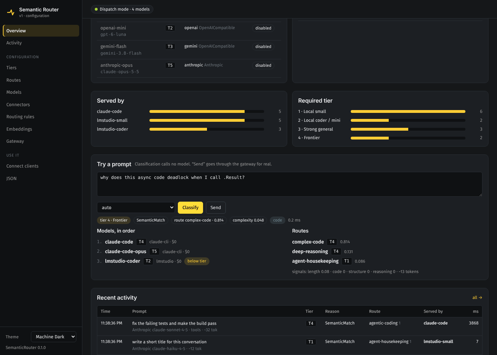
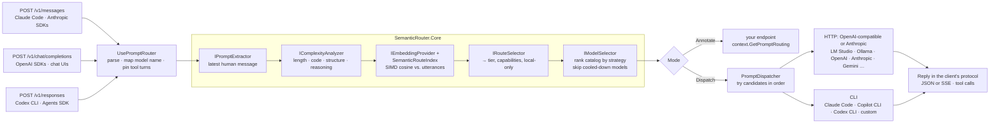

# SemanticRouter.NET

[](https://github.com/siebe41/SemanticRouter.NET/actions/workflows/ci.yml)
[](https://scorecard.dev/viewer/?uri=github.com/siebe41/SemanticRouter.NET)

A lightweight **semantic prompt router** for .NET 10 and ASP.NET Core. It sends every prompt to the **cheapest model that is capable enough to answer it**, choosing across:

- **local models** (LM Studio, Ollama, vLLM),
- **your own subscription CLIs** (Claude Code, GitHub Copilot CLI, Codex CLI),
- **paid APIs** (OpenAI, Anthropic, Gemini, Azure OpenAI, OpenRouter, …).

When a subscription hits its usage limit, the router cools that model down and moves on to the next-best one automatically.

It speaks **the OpenAI chat-completions, OpenAI Responses and Anthropic protocols**, so you can point **Claude Code**, **Codex CLI**, the OpenAI SDKs or any chat tool at it and keep working exactly as before: the tool keeps its own model names and its agentic loop, and the router decides which backend answers each turn. A built-in **dashboard** shows live activity and lets you edit every setting, with hot reload, and its **memory map** shows which of your notes (an Obsidian vault, Claude Code's memory, an MCP memory graph) reach local models and which reach the cloud.



It decides in two steps:

1. **What does this prompt need?** Embedding similarity against your intent clusters, plus cheap structural complexity heuristics, produce a required **capability tier**, required **capabilities** (`code`, `tools`, `vision`, …) and an optional **local-only** constraint.
2. **Which model should answer?** Your model catalog is ranked by a strategy: cheapest capable, most capable or your own priority. The router then tries the models in order through their connectors, failing over when a model is down or out of quota.

```text
prompt                                              needs                 → served by (LM Studio + Claude Code catalog)
"hello, how are you today?"                         tier 1                → lmstudio-small   (free, local)
"write a unit test for this function: …"            tier 2 + code         → lmstudio-coder   (free, local)
"compare event sourcing and CRUD trade-offs"        tier 4                → claude-code      (your subscription)
"summarize this, then analyze step by step…"        tier 1 → 3 by complexity → claude-code
"look up the customer record for account 4471"      tier 1, local only    → lmstudio-small   (never leaves the machine)
  … Claude session limit reached …                  tier 4                → lmstudio-coder   (best available; Claude cools down)
```

Three front doors: OpenAI-compatible (`POST /v1/chat/completions`, `GET /v1/models`) for any tool with a configurable base URL, the Anthropic Messages API (`POST /v1/messages`) for Claude Code and the Anthropic SDKs, and the OpenAI Responses API (`POST /v1/responses`) for Codex CLI and the Agents SDK. Send `"model": "auto"` and let the router choose, or keep the tool's own model names and map them with aliases.

---

## Contents

- [Features](#features)
- [How it works](#how-it-works)
- [Providers](#providers)
- [Install the tool](#install-the-tool)
- [Quick start from source](#quick-start-from-source)
- [Personal setup: LM Studio + your Claude subscription](#personal-setup-lm-studio--your-claude-subscription)
- [Using Claude Code and other tools through the router](#using-claude-code-and-other-tools-through-the-router)
- [The dashboard](#the-dashboard)
- [Using it in your application](#using-it-in-your-application)
- [Configuration reference](#configuration-reference)
- [Production guidance](#production-guidance)
- [Extensibility](#extensibility)
- [Building and testing](#building-and-testing)
- [Roadmap](#roadmap)
- [Changes, contributing and governance](#changes-contributing-and-governance)

The guides are also a website with search and the demo videos: <https://siebe41.github.io/SemanticRouter.NET/>. The [documentation index](docs/README.md) says which guide covers what: pointing Claude Code, Codex and SDKs at the router, the tool, its background service and the desktop app, the dashboard, each provider, routing quality and routing profiles, the memory map, usage and telemetry, network traffic, a machine-wide policy for administrators, verifying a release, the architecture, the roadmap, and why the subscription CLI connectors are built the way they are ([TERMS.md](docs/TERMS.md)).

---

## Features

- **Three protocols in, every backend out.** OpenAI chat completions, the OpenAI Responses API and the Anthropic Messages API are accepted; requests and replies are translated between them, including streaming, images and tool calls, and passed through untouched when client and backend speak the same protocol.
- **Built for agentic clients.** Point Claude Code or Codex at the router: their model names map through aliases, their tool-bearing turns go to tool-capable backends, the follow-up requests of a tool-calling turn stay on the model that started it, injected `<system-reminder>` blocks are ignored when classifying, and `count_tokens` is served locally. A CLI connector can even carry tools for them (*prompted tool calling*), so your Claude subscription can answer agentic turns.
- **See what you share.** Point the router at an Obsidian vault, Claude Code's own memory (`~/.claude`) or the MCP memory server's graph. The dashboard draws them as a graph and, for every request, shows which notes were in it and which model received them, local or cloud, live. Note text never leaves the router. See [docs/memory.md](docs/memory.md).
- **A dashboard with hot reload.** Live status, cooldowns, an activity log with every decision, a prompt tester, and an editor for routes, models, connectors, tiers, routing rules, embeddings and gateway settings. Apply changes to the running router, save them to a file, or revert. Themeable (Machine Dark by default).
- **Every model a provider has, each on its tier.** **Discover models** (or `semantic-router models`) lists what a connector offers and suggests a catalog entry for each: Claude's Haiku, Sonnet, Opus and Fable on four rungs, other known families (Qwen, Llama, DeepSeek, Gemma, gpt-oss, Gemini, …) from a model-family table you can extend, the rest of the local models by size, with tools, vision and context from the server's own report. It shows which local models are loaded and whether LM Studio or Ollama will load the others on demand. See [Model lineups](docs/providers.md#model-lineups-several-models-per-provider).
- **Named tiers.** The capability ladder is explicit configuration (`Tiers`), shown everywhere a tier appears, with a matrix of which routes need each rung and which models provide it.
- **Capability-aware, cost-aware routing.** Routes declare the tier and capabilities an intent needs. Models declare their tier, capabilities, context window, cost and priority. The selector picks the cheapest model that qualifies, the most capable one, the fastest lately, or follows your priority order, and clients can choose per request (`auto:cheapest`, `auto:best`, `auto:fastest`, `auto:balanced`, `auto:priority`).
- **Every kind of provider.** There is an OpenAI-compatible HTTP connector for local servers and APIs, a CLI connector that runs Claude Code, Copilot CLI or Codex CLI on your own login, a Copilot connector on GitHub's official SDK, and an `IChatConnector` interface for anything else.
- **Automatic failover and quota cooldowns.** A model that is unreachable, times out, returns 5xx/429 or reports a usage limit is skipped for a cooldown period. An account-wide subscription limit cools down every model on that account at once.
- **Privacy rails.** Routes marked `LocalOnly` can only be served by models marked `IsLocal`, even on failover. Once a conversation has been kept local, its later turns, tool loops and the client's compaction and title requests about it stay local too, and naming a cloud model does not take a local-only prompt off the machine. Subscription CLI connectors refuse requests from other machines by default.
- **Routing profiles.** Named policies for who is asking and what the code belongs to: allowed and denied models, tier floors and caps, a strategy, local-only. Picked by gateway key, header, model name (`auto@private`) or rules on project and tools; a conversation containing a credential can be kept local automatically. See [docs/routing-profiles.md](docs/routing-profiles.md).
- **Zero-dependency core.** `SemanticRouter.Core` references no NuGet packages. It has SIMD cosine similarity over `ReadOnlySpan<float>` (`System.Numerics.Vector<T>`), a tokenizer-free token estimator, complexity heuristics, and the route and model selectors. It is AOT-compatible.
- **Explainable decisions.** Every decision carries a reason, a tier, route similarities, complexity signals and the ranked model list. These are exposed through `X-Prompt-Route-*` headers, structured logs, metrics and a diagnostics endpoint.
- **Two middleware modes.** **Dispatch** serves requests through the connectors and streams the reply back. **Annotate** only attaches the routing plan, so your own endpoint makes the call.

## How it works



The classifier, router, connectors and extractor are rebuilt as one unit when configuration changes, so edits from the dashboard apply without a restart. [docs/architecture.md](docs/architecture.md) walks through a request step by step.

### Step 1: requirements from the prompt

**Semantic matching.** Each route is an intent cluster: example utterances plus the `Tier` (and optionally `RequiredCapabilities` and `LocalOnly`) that intent needs. Utterances are embedded once, in a batch, and stored L2-normalized in one contiguous matrix. Scoring a prompt costs one embedding call and a sweep of SIMD dot products (`MaxSimilarity` nearest neighbour, or `Centroid`). Only the prompt's prose is embedded: fenced code blocks, and unfenced runs of eight or more lines that look like pasted code or logs, are left out, so a long function under "write a unit test for this function" does not hide the instruction. A prompt that is only code is embedded whole, and the complexity heuristics below still read the code. Local-only routes are still checked against the whole prompt: while any route is `LocalOnly`, a prompt with something left out is embedded twice (prose and whole, in one call), and a local-only match of either keeps it local, so pasted private data cannot slip past a local-only route.

**Complexity heuristics.** A single pass extracts four signals in [0, 1]:

| Signal | Measures |
|---|---|
| Length | `sqrt(min(1, tokens / TokenSaturation))` from a BPE-like token estimate |
| Code | fenced code blocks, or runs of code-like lines |
| Structure | list items, headings, multiple questions, many lines |
| Reasoning | whole-word phrases such as *step by step*, *trade-offs*, *root cause*, *prove* |

These combine with a noisy-OR, `1 − Π(1 − weightᵢ·signalᵢ)`, so a single strong signal can raise the score on its own.

**Policy (`DefaultRouteSelector`).** Requirements only ever go **up**:

| Condition | Required tier | `RoutingReason` |
|---|---|---|
| Best route below its similarity threshold | `FallbackTier` (default 3) | `NoMatchFallback` |
| Route matched | the route's `Tier`, capabilities, `LocalOnly` | `SemanticMatch` |
| Other routes within `AmbiguityMargin` of the best | highest of their tiers; capabilities unioned; local-only is sticky | `AmbiguousMatchEscalation` |
| Complexity reaches a `ComplexityTiers` rule (default 0.45→2, 0.65→3, 0.85→4) | raised to that tier | `ComplexityEscalation` |
| Complexity ≥ `ComplexityShortCircuitThreshold` *(skipped while any route is local-only)* | tier from complexity alone, **no embedding call** | `ComplexityShortCircuit` |
| Request names a catalog model | that model only | `ModelOverride` |
| The message (or an earlier one in the conversation) starts with a callout such as `@opus` or `@tier2` | what the callout asks | `ExplicitCallout` |
| Classifier failed and `FailOpen` is on | `FallbackTier`, local-only while any route is local-only | `ClassifierFailure` |
| The conversation needed a higher tier on recent turns, e.g. "ok, go ahead" in the middle of a task (`Middleware:Conversation`, on by default) | the conversation's floor, which decays as it moves on to simpler work | `ConversationFloor` |
| The same client repeats a prompt soon after it was answered (`Middleware:RetryEscalation`, off by default) | one tier above the model that answered | `RetryEscalation` |
| A request an agentic client makes for itself, recognised by its wording: a session title, a topic check, a compaction summary, a warm-up ping, a shell command check (`Middleware:Housekeeping`, on by default) | `Housekeeping:Tier` (1), **no embedding call** | `ClientHousekeeping` |
| The first turn of a session the client resumed from a compaction summary ("This session is being continued from a previous conversation…") | `Housekeeping:ResumedTier` (4); later turns keep it as the conversation's floor | `ResumedSession` |

The request itself adds requirements. If it defines `tools`, the model must declare `tools`. If it contains images, the model must declare `vision`. The size of the whole conversation, including tool definitions, is checked against each model's `ContextWindow`.

### Step 2: choosing a model

A model is **eligible** when it is:
- enabled and not in cooldown,
- allowed by the request's routing profile, if it has one,
- inside its `ActiveHours`, if it has them,
- local, if the request is local-only,
- declares every required capability,
- has a context window that fits the request.

Eligible models that meet the required tier are ordered by the strategy:

| Strategy | Order | Use it when |
|---|---|---|
| `CheapestCapable` *(default)* | free local models (loaded ones first, then tier ↓), then free remote models such as subscriptions (tier ↑), then paid models (cost ↑, then tier ↑); then `Priority` ↑ | you want the cheapest model that is good enough. A local model costs nothing, so the most capable one that is already loaded answers, and nothing waits for a model to load. A subscription costs quota, so it comes after local models and its **lowest sufficient tier** goes first, saving premium quota for prompts that need it. |
| `MostCapable` | tier ↓, then cost ↑ | quality matters more than cost |
| `Priority` | your `Priority` ↑, then cost ↑ | you want explicit control |
| `Fastest` | typical time to first byte ↑, then cost ↑ | waiting matters more than cost |
| `Balanced` | the models within `BalancedLatencyFactor` of the fastest by cost ↑, then the rest by cost ↑ | cheap, but not much slower than the quickest |

A model's typical time to first byte is the median over its served turns in the last `LatencyWindow` (a day), each timed from when that model was asked (not counting a model that failed before it), once it has `LatencySamples` (5) of them. A model without enough turns counts as the median of the others; with no data at all, `Fastest` and `Balanced` order by cost. They pick the model and record why: the Activity page shows it, and Dispatch sends it as `X-Prompt-Route-Selection`, e.g. `fastest: quick (300 ms to first byte) over cheaper cloud (1,500 ms to first byte)`.

**Estimated cost counts the prompt cache.** A model that reads most of a long conversation from its prompt cache at a tenth of the input price can cost less than one with a lower list price and no cache. So the estimate splits the request's input by the share each model read from and wrote to its cache on recent served turns (`CacheShareWindow`, a day): that part at `CacheReadCostPerMillionTokens` and `CacheWriteCostPerMillionTokens`, the rest at the input price. The share is learned per route once a model has `CacheShareSamples` (5) turns with reported usage there, otherwise over all its turns; with fewer, the list prices apply, as they do for a model without cache prices. Every strategy's cost ordering uses this estimate, and so do the [per-route model trials](docs/routing-quality.md#cheaper-models-per-route). The Models page shows the effective input price next to the list price.

With `AllowBelowRequiredTier` (the default), the remaining eligible models follow, most capable first. When every tier-4 model is out of quota, a hard prompt still gets the best answer available rather than an error.

**Failover.** In Dispatch mode the router tries up to `MaxAttempts` candidates. Failover is only possible **before** any output reaches the client; once tokens are streaming, that model owns the response. Failures put the model into cooldown:

| Failure | Cooldown |
|---|---|
| Unreachable, timeout, HTTP 401/403/404/408/5xx, CLI crash | `FailureCooldown` (30 s) |
| HTTP 429, a CLI usage-limit message ("You've hit your session limit", "usage limit", …) | `QuotaCooldown` (15 min) |
| Account-wide CLI limit (session/weekly) | every model on that connector |

`GET /v1/models` shows which models are cooling down and until when.

## Providers

| Provider | Connector | Billing | Notes |
|---|---|---|---|
| LM Studio, Ollama, vLLM, llama.cpp server | `OpenAICompatible` | free (local) | mark `IsLocal: true` |
| OpenAI, Azure OpenAI, OpenRouter, Groq, Mistral, LiteLLM | `OpenAICompatible` | per token (API key) | |
| Anthropic API | `OpenAICompatible` (Anthropic's OpenAI-compatible endpoint) | per token (API key) | |
| Google Gemini API | `OpenAICompatible` (`/v1beta/openai/chat/completions`) | per token (API key) | |
| **Claude Code CLI** | `Cli`, preset `ClaudeCode` | your Claude subscription | personal, local use; see [TERMS.md](docs/TERMS.md) |
| **GitHub Copilot (SDK)** | `Copilot` | your Copilot plan (AI credits) | personal, local use; native tools and streaming; [providers.md](docs/providers.md#github-copilot-sdk) |
| **GitHub Copilot CLI** | `Cli`, preset `GitHubCopilot` | your Copilot plan (AI credits) | personal, local use |
| **OpenAI Codex CLI** | `Cli`, preset `Codex` | your ChatGPT plan | personal, local use |
| Anything else with a CLI | `Cli`, preset `Custom` | – | argument template with `{model}`, `{prompt}` |
| Anything else | your own `IChatConnector` | – | |

The subscription connectors (the CLIs and Copilot) answer with whatever account the CLI is signed in to, which may be a personal plan. On a work machine, read [Using it at work](docs/TERMS.md#using-it-at-work) first.

Not included, on purpose:
- **GitHub Models API:** retired on 30 July 2026.
- **Gemini CLI on a Google login:** consumer login was shut off in June 2026, and Google's terms prohibit piggybacking on the CLI's OAuth. Use the Gemini API with a key instead.

[docs/providers.md](docs/providers.md) has setup steps for each provider.

## Install the tool

The fastest way to use the router is the `semantic-router` .NET tool. It needs the [.NET 10 runtime or SDK](https://dotnet.microsoft.com/download/dotnet/10.0) and nothing cloned:

```bash
dotnet tool install -g SemanticRouter.Host
semantic-router init      # finds LM Studio / Ollama models and the claude, codex and copilot CLIs; no server needed for embeddings
semantic-router doctor    # checks every connector without calling a model, and lists every host the router contacts
semantic-router models    # lists what each connector offers, with suggested tiers
semantic-router           # http://localhost:5080, dashboard at /router
semantic-router service install   # or keep it running in the background, started whenever you sign in
```

`init` writes `~/.config/semantic-router/semantic-router.json` (`~/Library/Application Support/semantic-router` on macOS, `%APPDATA%\semantic-router` on Windows). When the router starts, it prints the lines to paste into your shell for Claude Code and OpenAI clients; [Using Claude Code and other tools through the router](#using-claude-code-and-other-tools-through-the-router) explains them. `init` asks before enabling each subscription CLI it finds, because that CLI answers on whatever account it is signed in to ([Using it at work](docs/TERMS.md#using-it-at-work)); `--yes` enables them without asking and `--no-cli` leaves them out. Everything else is done on the dashboard. `service install` sets the router up as a per-user background service (systemd on Linux, launchd on macOS, a sign-in entry on Windows), so no terminal has to stay open. Prefer an icon? The [desktop app](docs/desktop.md) (an installer for Windows, macOS and Linux, with updates) runs the router from the tray and shows the dashboard in its own window or your browser. A container image covers API-key and local-model setups. See [docs/host.md](docs/host.md).

## Quick start from source

To work on the library or try the samples, you need the [.NET 10 SDK](https://dotnet.microsoft.com/download/dotnet/10.0), feature band 10.0.4xx ([`global.json`](global.json)).

```bash
git clone https://github.com/siebe41/SemanticRouter.NET.git
cd SemanticRouter.NET
dotnet test
dotnet run --project samples/RoutingApiSample --launch-profile annotate
```

The sample starts in **Annotate** mode with in-memory hashing embeddings. It needs no model, CLI or key. Open the dashboard at <http://localhost:5080/router>, or ask it which model it *would* use:

```bash
curl -s http://localhost:5080/semantic-router/classify \
  -H 'Content-Type: application/json' \
  -d '{"prompt":"why does this async code deadlock when I call .Result?"}'
```

```json
{
  "requiredTier": 4, "reason": "SemanticMatch", "route": "complex-code", "similarity": 0.81,
  "localOnly": false, "requiredCapabilities": ["code"],
  "routes":  [{ "route": "complex-code", "tier": 4, "similarity": 0.81 }, …],
  "models":  [{ "model": "claude-code", "connector": "claude-cli", "tier": 4, "estimatedCostUsd": 0, "meetsRequiredTier": true },
              { "model": "claude-code-opus", … }, { "model": "lmstudio-coder", …, "meetsRequiredTier": false }],
  "complexity": { "score": 0.048, "estimatedTokens": 13, … }
}
```

A prompt that starts with a [callout](docs/clients.md#telling-the-router-what-you-want) (`@opus …`) is routed as the gateway routes a first turn with it: the response's `callout` names the tag and the prompt is classified without it.

`samples/RoutingApiSample/RoutingApiSample.http` has a request for every routing outcome.

## Personal setup: LM Studio + your Claude subscription

> **Start here:** [`samples/LmStudioClaudePoc`](samples/LmStudioClaudePoc/README.md) is a ready-to-run proof of concept for exactly this setup. Run `dotnet run --project samples/LmStudioClaudePoc -- --demo`; it checks both backends, then shows prompts being routed live.

This is the "use local models for the easy stuff, my subscription for the hard stuff" configuration.

1. **LM Studio.** Load a small chat model, a coder model and an embedding model (e.g. `text-embedding-nomic-embed-text-v1.5`), then start the server on port 1234. Check the exact model IDs with `curl http://localhost:1234/v1/models` and put them in `appsettings.json` (`Models[].Model`, `Embeddings:Model`).
2. **Claude Code.** Install it and sign in once by running `claude` and using `/login`. The router never sees your credentials: it runs the `claude` binary, which uses its own login.
3. **Run the router.**
   ```bash
   dotnet run --project samples/RoutingApiSample --launch-profile dispatch
   ```
4. **Point your tools at it.** Base URL `http://localhost:5080/v1`, any API key, and model `auto`:
   ```bash
   curl -N http://localhost:5080/v1/chat/completions -H 'Content-Type: application/json' \
     -d '{"model":"auto","stream":true,"messages":[{"role":"user","content":"Compare event sourcing and CRUD"}]}'
   ```

5. **Or point Claude Code at it** and keep using Claude Code as before:
   ```bash
   ANTHROPIC_BASE_URL=http://localhost:5080 ANTHROPIC_AUTH_TOKEN=semantic-router claude --model semantic-router
   ```
   See [Using Claude Code and other tools through the router](#using-claude-code-and-other-tools-through-the-router).

Enable `copilot`, `codex` or the paid API models in `appsettings.json` or the dashboard as you need them. With `CheapestCapable`:
- free local models answer whatever they are good enough for;
- flat-rate subscriptions take the hard prompts;
- paid APIs are used only when nothing cheaper qualifies (for example, a request with images, which CLI connectors cannot handle, or with `tools` when no local model or `ToolCalling: Prompted` CLI connector carries them) or when everything cheaper is cooling down.

## Using Claude Code and other tools through the router

The router is a drop-in base URL. Claude Code speaks the Anthropic Messages API, so:

```bash
export ANTHROPIC_BASE_URL=http://localhost:5080
export ANTHROPIC_AUTH_TOKEN=semantic-router   # any value; the router never reads or forwards it
claude --model semantic-router
```

`--model semantic-router` makes Claude Code show that the router picks the model. The router's start-up banner also prints `CLAUDE_CODE_MAX_CONTEXT_TOKENS` for your models ([docs/clients.md](docs/clients.md#claude-code)). Nothing else about your workflow changes. Claude Code keeps its system prompt, its tools and its model names; the router decides per turn:

| Claude Code sends… | The router… |
|---|---|
| its default `claude-opus-…`, `/model sonnet`, `haiku` for side tasks | maps the name through `Middleware:ModelAliases`: the `init` template routes every Claude name as `auto`, and `*haiku*` as `auto:cheapest`. Claude Code sends its default Opus name whether or not you chose Opus, so ask for Opus with `@opus` or `--model opus-pinned`. Unknown names route as `auto`, catalog names force that model |
| a turn with tools (every main-loop turn) | requires `tools`: HTTP models declaring it (a local coder model, an API-key model) or a CLI connector with `ToolCalling: Prompted` |
| tool results (the loop continuing) | pins the request to the model that issued the tool calls (`ConversationAffinity`) |
| `<system-reminder>` and other injected context blocks, `count_tokens` calls | ignores the former when classifying; answers the latter from its own estimator |

**Where agentic turns can go.** A tool-bearing turn needs a backend that carries tools: an OpenAI-compatible model with function calling (LM Studio or Ollama with `qwen3-coder`, vLLM, OpenRouter, OpenAI), an `Anthropic` connector (API key, requests pass through untouched), or a CLI connector with **prompted tool calling**: the tools are described in the prompt, the model answers with a fenced `tool_call` block, the router turns it into a real `tool_use`, and Claude Code runs the tool as usual. The subscription stays text-in/text-out; it costs more quota than native use because every turn re-sends the context. Details, limits and snippets for Codex, the OpenAI SDKs, Aider and curl: [docs/clients.md](docs/clients.md).

## The dashboard

```csharp
app.MapRouterDashboard("/router");   // UI at /router, admin API under /router/api (loopback only unless a token is set)
builder.Services.AddSemanticPromptRouting(config).UseConfigurationFile("semantic-router.json");   // optional: persist changes
```

A rail of five sections, each with its pages as tabs. **Monitor**: Overview (models and cooldowns, connector health, the weekly digest, served-by and required-tier charts, a prompt tester), Live (a streaming view of clients, the router and models, with every decision as it happens), Activity (every routed request with its decision and outcome), Usage, and Memory (your notes as a graph, coloured by which models they reached; see [docs/memory.md](docs/memory.md)). **Routing**: editors for Tiers, Routes, Rules and Profiles, Evaluate, and Router learned (what automatic tuning changed, each change undoable). **Providers**: Models, Connectors and Embeddings. **Gateway**: its settings and Connect clients. **Admin**: the JSON editor and the Audit log. **Report an issue** (a pre-filled GitHub issue for a misroute, a bug or an idea) sits at the foot of the rail ([every page](docs/dashboard.md#pages)). **Validate** → **Apply & save** swaps a new runtime in atomically and writes the configuration file (**Apply only** leaves the file as it is, and the top bar says the running configuration is not saved), which replaces the `SemanticRouter` section on the next start (secrets left empty are inherited from it). The admin API behind it takes the same JSON document, so a tested configuration can be promoted with one `PUT`. Themes are CSS token blocks; drop a token file into `themes/` next to the configuration and it appears in the picker after a reload. It works with a keyboard and a screen reader, and on a phone. See [docs/dashboard.md](docs/dashboard.md).

## Using it in your application

### Dispatch mode: the router is your gateway

```csharp
var builder = WebApplication.CreateBuilder(args);
builder.Services.AddSemanticPromptRouting(builder.Configuration.GetSection("SemanticRouter"));

var app = builder.Build();
app.UsePromptRouter();          // serves POST /v1/chat/completions, /v1/messages and /v1/responses (Middleware:PathPrefixes / AnthropicPathPrefixes / ResponsesPathPrefixes)
app.MapRouterModels();          // GET /v1/models
app.MapAnthropicTokenCount();   // POST /v1/messages/count_tokens
app.MapRouterDashboard();       // the dashboard and admin API at /router
app.Run();
```

**HTTP connectors** forward the original body untouched apart from `model` when the client speaks their protocol, so tool calls, images and SSE pass straight through; otherwise they translate the request and the reply (JSON or SSE) between the OpenAI and Anthropic formats. The client's own `Authorization`/`x-api-key` headers are never forwarded; credentials come from configuration.

**CLI connectors** turn the conversation into a prompt, run the CLI with its tools disabled, and return a reply in the client's protocol (`chat.completion` or an Anthropic `message`, streamed when asked). With `ToolCalling: Prompted` they also carry the client's tools.

### Annotate mode: your endpoint makes the call

```csharp
app.UsePromptRouter();

app.MapPost("/chat", async (ChatRequest request, HttpContext context, MyClients clients) =>
{
    RoutingPlan plan = context.GetPromptRouting()!;
    ModelDefinition model = plan.Candidates[0].Model;     // best model; the rest are fallbacks
    return await clients.For(model.Connector).CompleteAsync(model.Model, request);
});
```

### Code-first configuration

```csharp
builder.Services
    .AddSemanticPromptRouting(o =>
    {
        o.DefaultSimilarityThreshold = 0.65f;
        o.Routes.Add(new RouteDefinition { Name = "smalltalk", Tier = 1, Utterances = { "hi", "thanks!", "how are you?" } });
        o.Routes.Add(new RouteDefinition { Name = "design", Tier = 4, Utterances = { "design a scalable architecture" } });
    })
    .AddConnector("lmstudio", c => c.BaseAddress = new Uri("http://localhost:1234"))
    .AddConnector("claude-cli", c => { c.Type = ConnectorType.Cli; c.Preset = CliPreset.ClaudeCode; })
    .AddModel(new ModelDefinition { Name = "local", Connector = "lmstudio", Model = "qwen/qwen3-8b", Tier = 1, IsLocal = true })
    .AddModel(new ModelDefinition { Name = "claude", Connector = "claude-cli", Model = "sonnet", Tier = 4 })
    .UseOpenAICompatibleEmbeddings(e =>
    {
        e.Endpoint = new Uri("http://localhost:1234");
        e.Model = "text-embedding-nomic-embed-text-v1.5";
    })
    .ConfigureMiddleware(m => { m.Mode = PromptRouterMode.Dispatch; m.PathPrefixes.Add("/v1/chat/completions"); });
```

### Core only (console apps, workers, agent frameworks)

```csharp
var options = new SemanticRouterOptions { DefaultSimilarityThreshold = 0.3f };
options.Routes.Add(new RouteDefinition { Name = "summarize", Tier = 1, Utterances = { "summarize this article" } });
options.Models.Add(new ModelDefinition { Name = "local", Connector = "lmstudio", Tier = 1, IsLocal = true });
options.Models.Add(new ModelDefinition { Name = "frontier", Connector = "api", Tier = 4, InputCostPerMillionTokens = 3, OutputCostPerMillionTokens = 15 });

var router = new PromptRouter(new SemanticPromptClassifier(new HashingEmbeddingProvider(), options), options);
RoutingPlan plan = await router.RouteAsync(new PromptRoutingRequest { Prompt = "please summarize this article about Rust" });
// plan.Classification.RequiredTier == 1, plan.Candidates[0].Model.Name == "local"
```

## Configuration reference

Everything binds from the `SemanticRouter` section. `samples/RoutingApiSample/appsettings.json` is a complete annotated example.

### `SemanticRouter`

| Key | Default | Description |
|---|---|---|
| `Routes[]` | `[]` | Intent clusters (below). |
| `Models[]` | `[]` | The model catalog (below). |
| `Connectors:{name}` | `{}` | How to reach providers (below). |
| `Tiers[]` | 5 built-in levels | `{ Level, Name, Description }`: names for the tier numbers, shown by the dashboard and `/v1/models`. Routing compares the numbers. |
| `DefaultSimilarityThreshold` | `0.75` | Minimum cosine similarity for routes without their own threshold. |
| `FallbackTier` | `3` | Tier required when nothing matches or classification fails. |
| `ComplexityTiers[]` | 0.45→2, 0.65→3, 0.85→4 | `{ MinScore, Tier }` rules that raise the tier. An empty list disables them. |
| `ComplexityShortCircuitThreshold` | `0.9` | Skip embedding for obviously hard prompts. Set above 1 to disable. |
| `AmbiguityMargin` | `0.02` | Near-tied routes contribute their tier. `0` disables. |
| `ScoringStrategy` | `MaxSimilarity` | `MaxSimilarity` or `Centroid`. |
| `EmbedProseOnly` | `true` | Embed a prompt without its fenced code blocks and long pasted code or logs (eight or more lines that look like code). Local-only routes are still checked against the whole prompt. `false` embeds the whole prompt. |
| `ClassificationCache:Enabled` / `MaxEntries` / `MaxAge` | `true` / `2048` / `00:10:00` | Reuse a recent decision for the same prompt (whitespace-normalised) instead of embedding it again. In memory, per configuration version. |
| `Profiles:{name}` | `{}` | Routing profiles: `AllowedModels[]`, `DeniedModels[]` (globs), `AllowedConnectors[]`, `DeniedConnectors[]`, `MinTier`, `MaxTier`, `Strategy`, `LocalOnly`, `Description`. See [docs/routing-profiles.md](docs/routing-profiles.md). |
| `Complexity:*` | | `TokenSaturation`, `{Length,Code,Structure,Reasoning}Weight`, `ReasoningKeywords`, … |
| `Selection:Strategy` | `CheapestCapable` | `CheapestCapable`, `MostCapable`, `Priority`, `Fastest` or `Balanced`. |
| `Selection:BalancedLatencyFactor` | `1.5` | For `Balanced`: how many times slower than the fastest model a cheaper model may be. |
| `Selection:LatencyWindow` / `LatencySamples` | `1.00:00:00` / `5` | The recent served turns a model's typical time to first byte is taken from, and how many it needs. |
| `Selection:CacheShareWindow` / `CacheShareSamples` | `1.00:00:00` / `5` | The recent served turns the share of input a model reads from and writes to its prompt cache is taken from, and how many it needs (per route, or over all its turns), for cost estimates. |
| `Selection:AllowBelowRequiredTier` | `true` | Degrade to the best available model instead of failing. |
| `Selection:MaxAttempts` | `3` | Models tried per request. |
| `Selection:QuotaCooldown` / `FailureCooldown` | `00:15:00` / `00:00:30` | How long failed models are skipped. |
| `Selection:EstimatedOutputTokens` | `512` | Used for cost estimates and context-window checks. |
| `Selection:TimeZone` | this machine's | IANA zone that models' `ActiveHours` follow. |

### `Routes[]`

| Key | Default | Description |
|---|---|---|
| `Name` | – | Unique. |
| `Tier` | `1` | Minimum model tier. Suggested scale: 1 small local · 2 mid/mini · 3 strong · 4 frontier · 5 frontier + deep reasoning. |
| `RequiredCapabilities[]` | `[]` | Tags the model must declare (e.g. `code`). |
| `Utterances[]` | – | 5–20 diverse examples. |
| `SimilarityThreshold` | `null` | Per-route override. |
| `LocalOnly` | `false` | Only `IsLocal` models may answer, even on failover. |
| `PreferredModel` | none | A catalog model that serves the route's plain matches first, even below `Tier`. Automatic tuning sets it when a trial of a cheaper model goes well ([docs](docs/routing-quality.md#cheaper-models-per-route)); escalated, explicit and conversation-held turns are routed by the tier. |
| `FollowsConversation` | `false` | Prompts that say nothing about difficulty ("go ahead", "continue"): in a conversation they take its tier, down as well as up; `Tier` applies only on a first turn. The `init` template's `continuation` route has it. |

### `Models[]`

| Key | Default | Description |
|---|---|---|
| `Name` | – | Unique catalog name. Clients may request it directly as `model`. |
| `Connector` | – | Name of a configured connector. |
| `Model` | `null` | Provider model ID sent to the connector (e.g. `qwen/qwen3-8b`, `sonnet`, `gpt-6.1-sol`). |
| `Tier` | `1` | Capability tier. |
| `Capabilities[]` | `[]` | e.g. `chat`, `code`, `tools`, `vision`, `reasoning`. CLI-backed models declare `tools` only when their connector has `ToolCalling: Prompted`, and never `vision`. |
| `IsLocal` | `false` | Data stays on your machine. |
| `ContextWindow` | `0` (unknown) | Tokens. Models too small for a request are skipped. |
| `InputCostPerMillionTokens` / `OutputCostPerMillionTokens` | `0` | Marginal USD cost. Use 0 for local models and flat-rate subscriptions. |
| `CacheReadCostPerMillionTokens` / `CacheWriteCostPerMillionTokens` | input price | Prompt-cache prices, for the usage and cost figures and for cost estimates once the model's cache share is known. |
| `Priority` | `0` | Lower is preferred. Breaks ties; primary key for the `Priority` strategy. |
| `Enabled` | `true` | |
| `ActiveHours` | `null` (always) | `HH:mm-HH:mm`, may cross midnight. Outside the window the model is not tried. |

### `Connectors:{name}`

| Key | Applies to | Default | Description |
|---|---|---|---|
| `Type` | all | `OpenAICompatible` | `OpenAICompatible`, `Anthropic` (Messages API), `Responses` (OpenAI Responses API), `Cli`, or `Copilot` (GitHub's Copilot SDK; package `SemanticRouter.Connectors.Copilot`, included in the tool). |
| `BaseAddress`, `RequestPath` | HTTP | –, `/v1/chat/completions` (`/v1/messages` for Anthropic, `/v1/responses` for Responses) | |
| `ApiKey`, `Headers` | HTTP | | Bearer token (`x-api-key` for Anthropic) and extra headers. Keep keys in user-secrets or environment variables, or write a reference: `"${env:OPENAI_API_KEY}"`, `"${secret:…}"`. |
| `ForwardHeaders[]` | HTTP | `[]` | Client request headers to relay upstream (e.g. `anthropic-beta`). Authorization headers never are. |
| `AnthropicVersion` | Anthropic | `2023-06-01` | Sent as `anthropic-version`. |
| `PromptCaching` | Anthropic | `Auto` | `Auto`: requests translated from OpenAI and Responses clients get cache markers (end of the system prompt, plus automatic caching for the conversation) when the prompt is above the model's cacheable minimum. `Off`: none. See [providers.md](docs/providers.md#prompt-caching-on-translated-requests). |
| `CacheTtl` | Anthropic | `5m` | `5m` or `1h`: how long those cache entries live, and so how long conversation routing counts them warm. A one-hour entry costs 2× the input price to write instead of 1.25×. |
| `ToolCalling` | CLI | `None` | `None`: decline tool-bearing requests. `Prompted`: describe the tools in the prompt and parse `tool_call` blocks from the reply. |
| `StreamPromptedReplies` | CLI | `true` | With `Prompted`: stream the reply's text and hold back only what may be a tool call. `false` buffers the reply, so a failed run can still fail over. |
| `RepairToolCalls` | CLI | `true` | With `Prompted`: re-ask once, briefly, for a tool call that could not be read. See [providers.md](docs/providers.md#prompted-tool-calling-in-practice). |
| `PromptedToolParsing` | CLI | `Lenient` | With `Prompted`: `Strict` reads only the run's own randomly labelled fence, at the end of the reply, naming one of the request's tools, as a call; `Lenient` also takes near misses (bare JSON, other labels, calls followed by text). In both, tool results are defused and a call copied from one stays text. `Lenient` stays the default until `Strict` has been measured on smaller models. See [providers.md](docs/providers.md#forged-tool-calls). |
| `Preset` | CLI | `Custom` | `ClaudeCode`, `GitHubCopilot`, `Codex` or `Custom`. |
| `Executable` | CLI | preset's command | Started directly, never through a shell, by its full path: a bare name is looked up on the absolute `PATH` entries only, never in the current directory. On Windows use the `.exe`. |
| `Arguments[]` | CLI | | Custom: the full template (`{model}`, `{prompt}`). Presets: extra arguments appended. |
| `PromptInput` | CLI | `Stdin` | `Stdin` or `Argument`. `Argument` puts the prompt on the command line (Custom: the `{prompt}` placeholder), where other users of the machine can read it while the CLI runs. Codex always uses stdin. |
| `QuotaErrorPatterns[]` | CLI | preset patterns | Extra output fragments that mean "quota exhausted". |
| `EnvironmentVariables`, `RemoveEnvironmentVariables[]` | CLI | preset defaults | The presets remove API-key variables that would switch billing away from your subscription. |
| `MaxConcurrency` | CLI, Copilot | `2` | Simultaneous processes (Copilot: simultaneous turns). |
| `MaxQueue` | CLI, Copilot | `16` | When this many requests are already waiting for a process, the next goes to another model. `0`: never wait. |
| `MaxArgumentLength` | CLI | `24000` | With `PromptInput: Argument`, longer prompts are sent on stdin. Longer Claude Code system prompts are moved into the conversation. |
| `Executable`, `HomeDirectory` | Copilot | `copilot`, `~/.copilot` | The Copilot CLI the SDK runs as its runtime, and its `COPILOT_HOME`. |
| `AllowRemoteClients` | CLI, Copilot | `false` | See [TERMS.md](docs/TERMS.md) before changing this. |
| `Timeout` | all | HTTP 100 s · CLI 5 min | Time to first output. Streams are not cut off. |

### `Embeddings`, `Middleware` and the other sections

| Key | Default | Description |
|---|---|---|
| `Embeddings:Provider` | `Hashing` | `Hashing` (dev only), `Onnx` (in-process model, see below) or `OpenAICompatible` (`Endpoint`, `Model`, `ApiKey`, `RequestPath`, `MaxBatchSize`, `Timeout`). |
| `Embeddings:IsLocal` | loopback `Endpoint` only | Whether an `OpenAICompatible` endpoint keeps prompts on this machine (or a server you control). When it does not, requests already known to be local-only (a local-only profile, `LocalOnlyWhen`, `@local`, a conversation kept local) are classified by complexity alone instead of being sent to it, tuning and evaluation leave local-only prompts out, and a warning says that local-only routes still need every prompt embedded there first. |
| `Embeddings:Model` / `ModelPath` / `Pooling` | | For `Onnx`: `all-MiniLM-L6-v2` (default) or `bge-small-en-v1.5`, downloaded on first use; or `ModelPath`, a directory with your own `model.onnx` and `vocab.txt`, with `Pooling` `Mean` or `Cls`. Needs the `SemanticRouter.Embeddings.Onnx` package (`.AddOnnxEmbeddings()` / `.UseOnnxEmbeddings()`); the tool includes it. |
| `Embeddings:WarmUpOnStartup` | `true` | Embed utterances in the background at startup. |
| `Middleware:Mode` | `Annotate` | `Annotate` or `Dispatch`. |
| `Middleware:PathPrefixes[]` | `[]` (all JSON POSTs) | Paths carrying OpenAI chat-completions bodies. Required in Dispatch mode. |
| `Middleware:AnthropicPathPrefixes[]` | `/v1/messages` | Paths carrying Anthropic Messages bodies (Claude Code). Errors on them use the Anthropic format. |
| `Middleware:ResponsesPathPrefixes[]` | `/v1/responses` | Paths carrying OpenAI Responses bodies (Codex CLI). Only the path itself is routed; `/v1/responses/{id}` is not. |
| `Middleware:ModelAliases` | `{}` | Glob → alias/model map for client model names: `"*haiku*": "auto:cheapest"`, `"claude-*": "auto"`, `"opus-pinned": "family:opus"` (the catalog's Opus model, else the most capable). A key without `*` matches exactly and is tried before the globs. Catalog names, `auto:*` and the router's own names (`semantic-router`, `claude-semantic-router…`) are never remapped; unmatched names route as `auto`. |
| `Middleware:Feedback:Enabled` | `true` | Record signs that a decision was not good enough (retried, corrected, overridden with a callout, failing tool calls, empty reply, graded low by the judge) with the decision. See [docs/routing-quality.md](docs/routing-quality.md#feedback). |
| `Middleware:Feedback:CorrectionSimilarity` / `CorrectionMargin` | `0.72` / `0.12` | Recognise corrections no phrase covers (other wording, other languages) by comparing short follow-ups with example corrections using the routing embedding model. `0` turns it off. See [docs/routing-quality.md](docs/routing-quality.md#corrections-in-other-words). |
| `Tuning:Mode` | `Apply` | Automatic tuning of thresholds, utterances and cheaper models per route: `Apply` (shown under Router learned, each change undoable), `Suggest` or `Off`. See [docs/routing-quality.md](docs/routing-quality.md#automatic-tuning). |
| `Tuning:Interval` / `NewLabels` / `MaxStep` / `MinimumPrompts` | `1.00:00:00` / `10` / `0.02` / `20` | How often it runs, how many new labels make it run early, the most a threshold moves per run, and the labelled prompts it needs first. |
| `Tuning:FeedbackWeight` / `FeedbackDays` | `0.5` / `30` | How much a prompt labelled by feedback counts next to one you labelled, and how far back feedback is used. |
| `Tuning:JudgeWeight` / `JudgeAgreementPairs` | `0.75` / `10` | How much a prompt labelled only by the judge's low grade counts; once this many graded answers also have a hand label, the weight is scaled by how often the judge agrees with them. See [docs/routing-quality.md](docs/routing-quality.md#the-judge). |
| `Tuning:Utterances` / `MaxUtterancesPerRoute` / `LocalOnlyUtterances` | `true` / `2` / `false` | Add labelled prompts a route misses as its utterances, how many per route per run, and whether local-only prompts may be added. |
| `Tuning:HoldDays` / `StrongerEvidence` | `30` / `2` | How long an undone change is left alone, and how much stronger the evidence must be to suggest it again sooner. |
| `Tuning:ModelTrialRate` / `ModelTrialTurns` / `ModelTrialMargin` | `0.05` / `20` / `0.05` | Try the next cheaper model able to do a route's work on this share of its plain matches, for this many turns; it takes the route over (`PreferredModel`) when its turns draw at most this much more feedback than the current model's. `0` turns trials off. See [docs/routing-quality.md](docs/routing-quality.md#cheaper-models-per-route). |
| `Notifications:Enabled` | `true` | The one switch for notifications (a desktop notification, a log line, the webhooks) when something needs a decision. The Overview lists the notices either way. See [docs/dashboard.md](docs/dashboard.md#digest-and-notifications). |
| `Notifications:Webhooks` / `DashboardUrl` | | Webhooks (JSON, Slack-compatible or ntfy) that get each notice when it appears and clears, and the weekly digest; the URLs are secrets. `DashboardUrl` makes the links in them work. See [docs/dashboard.md](docs/dashboard.md#digest-and-notifications). |
| `Notifications:IncludeDetails` | `false` | Let webhook messages quote text that can come from prompts or replies: utterances tuning learned from prompts and the latest error a connector returned. Off, they carry only counts, names, kinds and links. |
| `Notifications:ConnectorDownAfter` / `LimitDays` | `01:00:00` / `3` | How long every request to a connector must fail before it counts as down, and on how many of the last 7 days a subscription must hit its usage limit before that needs a decision. |
| `Middleware:Reliability:Enabled` | `true` | Leave a model out of the work it keeps failing at (a route, or requests with tools) for a while. See [docs/routing-quality.md](docs/routing-quality.md#model-reliability). |
| `Middleware:Reliability:Window` / `MinimumTurns` / `MaxFailureRate` / `PeerMargin` / `Period` | `7.00:00:00` / `10` / `0.3` / `0.15` / `1.00:00:00` | How far back turns count, the turns needed before judging, the share with feedback that counts as unreliable, how much worse than the other models it must be, and how long it is left out. |
| `Middleware:Judge:Enabled` / `Model` | `false` / | Grade a sample of cheap answers with a catalog model (preferably local); a low grade is feedback the router learns from. See [docs/routing-quality.md](docs/routing-quality.md#the-judge). |
| `Middleware:Judge:SampleRate` / `MaxTier` / `DailyLimit` / `FailingGrade` / `MaxCharacters` | `0.02` / `2` / `100` / `2` / `6000` | The share of eligible answers graded, the highest tier whose answers are graded, the most grades a day, the grade (1–5) at or below which it is feedback, and how much of the request and answer the judge reads. |
| `Middleware:Housekeeping:Enabled` / `Tier` / `ResumedTier` / `Patterns` | `true` / `1` / `4` / `[]` | Recognise agentic clients' own requests (titles, topic checks, compaction, warm-ups, command checks) and route them to `Tier` without classifying; route a session resumed from a compaction summary to `ResumedTier`. `Patterns` adds regular expressions for other clients' wording; a `client-turns.json` next to the configuration replaces or turns off the built-in ones. See [docs/clients.md](docs/clients.md#claude-code). |
| `Middleware:Callouts:Enabled` / `Names` | `true` / `{}` | Inline callouts: a message starting with `@opus`, `@local`, `@best`, `@tier3`, a catalog model name or one of your `Names` routes as asked for the rest of the conversation, until `@auto`. See [docs/clients.md](docs/clients.md#telling-the-router-what-you-want). |
| `Middleware:PinToolCallingTurns` | `true` | Requests carrying tool results go to the model that issued the tool calls. |
| `Middleware:Conversation:Enabled` | `true` | Route by the conversation: keep the tier recent turns needed and stay on the model that answered. See [docs/routing-quality.md](docs/routing-quality.md#conversations). |
| `Middleware:Conversation:DecayTurns` / `IdleTimeout` / `ShortFollowUpLength` / `StickToModel` | `3` / `00:30:00` / `60` / `true` | Simpler turns before the floor drops a tier; how long an idle conversation is remembered; the length (characters) below which a message is a follow-up that keeps the full floor; whether to prefer the previous model, or the one with the conversation's warm prompt cache when moving would cost more. |
| `Middleware:Conversation:CacheLifetime` | `00:05:00` | How long a model's prompt cache counts as warm after a turn that used it, for backends whose cache lifetime the router cannot tell. On an Anthropic connector it follows the cache markers instead (`CacheTtl`, or the client's own `ttl`). See [routing-quality.md](docs/routing-quality.md#conversations). |
| `Middleware:Conversation:SessionHeader` | `x-claude-code-session-id` | A header with the client's session id. When a request has it, the session and the first user message identify the conversation, whatever the system prompt does. Empty turns it off. See [routing-quality.md](docs/routing-quality.md#conversations). |
| `Middleware:RetryEscalation:Enabled` / `Window` | `false` / `00:02:00` | A prompt repeated by the same client within the window goes one tier up. See [docs/routing-quality.md](docs/routing-quality.md#retry-escalation). |
| `Middleware:StripSystemReminders` | `true` | Ignore the context blocks clients inject into user messages when classifying: `<system-reminder>`, `<system_reminder>`, `<current_datetime>`, `<copilot_tauri_workspace>` and `Middleware:InjectedTags`. |
| `Middleware:InjectedTags` | `[]` | More tag names (e.g. `environment_details`) whose blocks are ignored when classifying. |
| `Middleware:MaxRequestBodyBytes` | `8388608` | Larger bodies get 413. Agentic clients send 100 KB+ requests. |
| `Middleware:EmitResponseHeaders` / `HeaderPrefix` | `true` / `X-Prompt-Route` | `X-Prompt-Route`, `-Tier`, `-Reason`, `-Similarity`, `-Complexity`, `-Model`, `-Connector`, `-Attempt`, `-Degraded`, `-Budget`, `-Dropped`, `-Profile`, `-Local-Only`, `-Unreliable`. |
| `Middleware:FailOpen` | `true` | Route with `FallbackTier` if classification fails. |
| `Middleware:MessageSelection` | `LastUserMessage` | Which messages are classified. |
| `Usage:ReferenceModel`, `Usage:TimeZone`, `Usage:WarnAtPercent` | –, local, `80` | Yardstick for "saved by routing", the zone budget periods follow, and when to warn. |
| `Usage:Budgets[]` | `[]` | `{ Name, Model or Connector or Profile, Period (Day/Week/Month), MaxTokens, MaxCostUsd }`. A spent budget's models are not tried until the period ends; a spent profile budget stops that profile's paid models only. |
| `Middleware:GatewayKeys` | `{}` | Client keys by name (`"laptop": "${env:ROUTER_KEY_LAPTOP}"`). Remote clients must send one as `Authorization: Bearer` or `x-api-key`, and are refused while none is set; the name is recorded in Activity. Never forwarded. |
| `Middleware:AllowUnauthenticatedRemoteClients` | `false` | Serve remote clients without a key while `GatewayKeys` is empty. Only behind a proxy that authenticates callers. |
| `Middleware:RemoteRequestsPerMinute` | `120` | Requests per minute for each client on another machine that no `RateLimits` entry covers. `0` turns it off. |
| `ForwardedHeaders:KnownProxies`, `KnownNetworks` | none | Reverse proxies whose `X-Forwarded-For` and `X-Forwarded-Proto` are believed (host setting, read at start-up). See [host.md](docs/host.md#serving-over-https). |
| `Network:Offline` / `AllowedHosts` | `false` / `[]` | Offline mode: the router reaches only this machine and these hosts; CLI and Copilot connectors are off and the ONNX model is never downloaded (host setting). See [network.md](docs/network.md#offline-mode). |
| `Network:CaBundle` | none | A PEM file of CA certificates trusted for the router's own HTTPS connections (connectors, embeddings, webhooks, the ONNX download) in addition to the system store, for a proxy that inspects TLS (host setting, read at start-up). See [network.md](docs/network.md#proxies-and-certificates). |
| `DataProtection:Certificate` | none | An RSA certificate (a PFX, a PEM with its key or `CertificateKey`, or a `CurrentUser\My` thumbprint) that encrypts the data-protection keys behind the secrets file, on any platform; `CertificatePassword` for its password (host setting, read at start-up). Without it they are encrypted with DPAPI on Windows and protected by file permissions only on macOS, Linux and in the container. See [host.md](docs/host.md#the-key-ring). |
| `State:StorePrompts` | `Redacted` | How much of each prompt the activity log keeps: `Redacted` (160 characters, credentials masked), `On`, or `Off`. The same goes for a failed CLI run's output (in the activity log and the logs) and the judge's reason. See [host.md](docs/host.md#what-the-router-stores). |
| `State:Retention` | store defaults | `ActivityDays` (30), `ActivityEntries` (10,000), `UsageDays` (400), `ConfigurationVersions` (200), `AuditDays` (365, the [audit log](docs/dashboard.md#audit-log)). |
| `Middleware:RequireGatewayKeyForLocalClients` | `false` | Require the key from loopback clients too (a local reverse proxy). |
| `Middleware:RateLimits` | `{}` | Per gateway client (and `*` for the rest): `{ RequestsPerMinute, TokensPerMinute }` over a sliding minute. A client over its limit gets `429` with `Retry-After` in its protocol, recorded in Activity. See [docs/dashboard.md](docs/dashboard.md#rate-limits). |
| `Middleware:ProfileHeader` / `ProjectHeader` | `X-Router-Profile` / `X-Router-Project` | Headers that name the routing profile and the project. Without the project header, the project is a hash of the client's user id (`user:` and 12 hex digits), never the id itself; a user id that is a JSON object (Claude Code's) gives no project. |
| `Middleware:ClientProfiles` | `{}` | Gateway client → profile it always runs under. |
| `Middleware:ProfileRules[]` | `[]` | `{ Profile, Clients[], Projects[], ToolsInclude[], ToolsExclude[] }`; the first match picks the profile. |
| `Middleware:VirtualModels` | `{}` | Model names clients can pick: `{ "private": { "Profile": "private", "Strategy": null, "Description": "…" } }`. |
| `Middleware:LocalOnlyWhen:Secrets` / `FilePaths` | `false` / `false` | Keep a conversation local when it contains a credential or an absolute file path. |
| `Dashboard:AdminToken`, `Dashboard:ReadOnlyToken` | | Tokens for remote dashboard access (16+ characters). See [docs/dashboard.md](docs/dashboard.md#access-and-security). |
| `Dashboard:MetricsToken` | | Token for figures only: status, usage and the digest's counts, never prompt text, the configuration or activity. See [docs/dashboard.md](docs/dashboard.md#roles). |
| `Dashboard:SessionLifetime` | `12:00:00` | How long a dashboard sign-in lasts before the token must be entered again; signing out ends the session on the server. Five wrong tokens from one address in 15 minutes make it wait (`429`) until the first is 15 minutes old. |
| `Dashboard:AllowProcessSettings` | `false` | Let the admin API change what a CLI connector runs and which paths memory sources read; otherwise those change only in the configuration file. See [docs/dashboard.md](docs/dashboard.md#access-and-security). |
| `Dashboard:RequireLocalClient` | `true` | Loopback only. Turn off together with a token to reach the dashboard from other machines. |
| `Dashboard:PublicOrigins[]` | `[]` | Addresses the dashboard is reached at besides `localhost` (`https://router.home.lan`): changes are accepted from these origins. |
| `Dashboard:RequireTokenForLocalClients` / `AllowUnauthenticatedRemoteClients` | `false` / `false` | Require a token from loopback clients too (a reverse proxy on this machine); serve remote clients without a token (only behind a proxy that authenticates them). See [docs/dashboard.md](docs/dashboard.md#access-and-security). |
| `Dashboard:TrustedIdentityHeader` / `TrustedGroupsHeader` | none | Header in which an authenticating reverse proxy names the signed-in user (`X-Forwarded-User`, `X-Auth-Request-Email`) and, optionally, their groups. Believed only from `ForwardedHeaders:KnownProxies`/`KnownNetworks`. See [docs/dashboard.md](docs/dashboard.md#signed-in-users-from-a-reverse-proxy). |
| `Dashboard:TrustedIdentityRoles` | `{}` | Role per user or group the proxy names, `*` for everyone else: `{ "alice@corp.example": "Admin", "finance": "Metrics", "*": "ReadOnly" }`. A user with no role gets `403`. |
| `Dashboard:ThemesDirectory` | `themes/` next to the configuration file | Drop-in theme files. See [docs/dashboard.md](docs/dashboard.md#adding-a-theme-without-rebuilding). |
| `Memory:Sources[]` | none | `{ Name, Type, Path }`: an Obsidian vault or notes folder (`Markdown`), Claude Code's memory (`ClaudeCode`, default `~/.claude`) or the MCP memory server's graph (`KnowledgeGraph`). See [docs/memory.md](docs/memory.md) for the rest of the `Memory` keys. |

### Thresholds by embedding model

Similarity scales differ between embedding models. These are starting points. Calibrate on your own prompts with the dashboard's **Evaluate** page, which sweeps the threshold over a labelled set and recommends a value ([docs/routing-quality.md](docs/routing-quality.md)).

| Embedding model | Starting `DefaultSimilarityThreshold` |
|---|---|
| `HashingEmbeddingProvider` (lexical, dev only) | 0.25–0.35 (the template and samples: 0.30) |
| ONNX `all-MiniLM-L6-v2` (in-process) | 0.40, what `init` sets (best on the sample set: 0.29) |
| ONNX `bge-small-en-v1.5` (in-process) | 0.60, what `init` sets (best on the sample set: 0.60–0.63) |
| `nomic-embed-text` | 0.60–0.70 |
| `mxbai-embed-large` | 0.65–0.75 |
| OpenAI `text-embedding-3-*` | 0.40–0.55 |

### Classification latency

Classifying a prompt is one embedding plus a dot product per utterance. Measured on the starting routes (119 utterances) and the 116-prompt sample set that `init` writes, with the classification cache off so every prompt is embedded. The machine had 4 logical CPUs and ran Linux. Reproduce with `dotnet run -c Release --project benchmarks/SemanticRouter.Benchmarks`; add `-- --remote http://localhost:11434 nomic-embed-text` to measure an embedding server.

| Embeddings | Index warm-up | Classify p50 | Classify p95 | Right on the sample set |
|---|---|---|---|---|
| Hashing (lexical) | 9 ms | 0.08 ms | 0.11 ms | 100/116 at 0.30 |
| ONNX `all-MiniLM-L6-v2` | 226 ms | 1.9 ms | 2.5 ms | 111/116 at 0.40 |
| ONNX `bge-small-en-v1.5` | 389 ms | 3.2 ms | 3.9 ms | 112/116 at 0.60 |

An embedding server adds a network round trip and its own inference time to every prompt. A prompt the cache has seen recently costs no embedding at all.

## Production guidance

- **Use a real embedding model.** The hashing provider only captures shared words. `Onnx` runs one inside the router with no server; an OpenAI-compatible server (LM Studio, Ollama) works too.
- **Secrets.** Keep API keys in user-secrets, environment variables (`SemanticRouter__Connectors__openai__ApiKey`) or a vault, never in `appsettings.json`. Any key, header or gateway key can be a reference instead of a value: `"${env:OPENAI_API_KEY}"`. With `.UseSecretFile()`, keys typed into the dashboard are encrypted into a separate file and the configuration keeps a `${secret:…}` reference; the keys that decrypt it are encrypted with DPAPI on Windows, or to a certificate anywhere with `DataProtection:Certificate` ([host.md](docs/host.md#the-key-ring)). Keys are redacted from error details, relayed upstream errors, activity entries and logs.
- **Bind to localhost** when the router fronts your personal subscriptions (the sample does). CLI connectors refuse non-loopback clients anyway, unless `AllowRemoteClients` is set. Behind a reverse proxy, every request appears to come from the proxy, so keep the proxy local too.
- **Pipeline placement.** Call `UsePromptRouter()` after authentication and rate limiting.
- **Diagnostics.** Protect `MapPromptClassification()` or map it only in development. Set `EmitResponseHeaders: false` to hide routing from clients.
- **The dashboard** and its admin API change where prompts go and can show connector settings (keys are masked). By default they answer loopback clients only, and only when the `Host` header names this machine (so a web page cannot reach them through DNS rebinding); changes must come from the dashboard's own origin. To use them from another machine, set `Dashboard:AdminToken` (and optionally `ReadOnlyToken` or `MetricsToken`) and turn `RequireLocalClient` off; see [docs/dashboard.md](docs/dashboard.md#access-and-security). Keep the saved configuration file out of source control.
- **Resilience.** HTTP connectors use the named clients `SemanticRouter.Connector.{name}`, and embeddings use `SemanticRouter.Embeddings`. You can add `Microsoft.Extensions.Http.Resilience` handlers to them.
- **Telemetry.** The `SemanticRouter` activity source traces each request (route, classify, select, one span per attempt, `traceparent` to HTTP backends). The `SemanticRouter` meter publishes decisions, latency, time to first byte, tokens, cost, cooldowns, failovers, budget skips and CLI queue depth. Every decision is also logged with its tier, route, similarity, complexity and first-choice model, under a `RouteRequestId` scope that matches the `X-Prompt-Route-Id` response header. No prompt text appears in spans or metrics. See [docs/observability.md](docs/observability.md).
- **Usage and budgets.** Tokens and cost per request, the dashboard's Usage page, "saved by routing" against a reference model, and per-model or per-connector budgets that stop a model before a limit is hit. See [docs/observability.md](docs/observability.md#budgets).

### Known limitations

- **State is per process unless you persist it.** Cooldowns, tool-call affinity, warm prompt caches, activity, usage and configuration history live in memory unless `UseSqliteState` is used (the `semantic-router` tool does). The memory map's sharing counts always start at zero on a restart. Configuration applied through the dashboard is persisted only when a configuration file is registered.
- **CLI connectors are text in, text out.** Without `ToolCalling: Prompted`, requests with `tools` skip them. With it, tool calls depend on the model following the format, every turn re-sends the whole context, and images are never supported. Multi-turn chats are flattened into a labelled transcript. Each request starts a new process, which adds start-up latency compared with an HTTP call.
- **Cross-protocol translation keeps what has an equivalent.** Tools, tool results, images, system prompts, sampling parameters, stop sequences, reasoning requests and replies, structured output and serial tool calls are translated. Documents, `logprobs`, hosted tools and server-side conversation state only survive on pass-through to a backend that speaks the client's protocol. Prompt caches keep working: an Anthropic client's `cache_control` markers reach Anthropic backends, requests translated for an Anthropic backend get markers of their own (`PromptCaching`), and OpenAI's `prompt_cache_key` crosses between chat completions and Responses. Whatever is left out is named in `X-Prompt-Route-Dropped`; see the [compatibility table](docs/providers.md#what-survives-translation).
- **Token counts are estimates.** Leave headroom in `ContextWindow`.
- **The CLI presets track the vendors' documented flags as of October 2026.** If a CLI changes, add flags through `Arguments` or use the `Custom` preset.

## Extensibility

| To… | Do this |
|---|---|
| Add a provider with its own protocol | Implement `IChatConnector` and call `.AddConnector<T>()`. To make a new connector type selectable in configuration, register an `IChatConnectorFactory`; implement `IModelDiscovery` for the dashboard's Discover button. |
| Keep configuration somewhere other than a file | Implement `IRouterConfigurationStore` and call `.UseConfigurationStore<T>()`. |
| Use another embedding backend | Implement `IEmbeddingProvider` and call `.UseEmbeddingProvider<T>()`. For an in-process model: `.UseOnnxEmbeddings()` from `SemanticRouter.Embeddings.Onnx`. To make a new kind selectable in configuration, register an `IEmbeddingProviderFactory`. |
| Change how requirements are derived | Implement `IRouteSelector` or `IComplexityAnalyzer`. |
| Change how models are ranked (budgets, time of day) | Implement `IModelSelector`. |
| Persist cooldowns, affinity, activity and history | `.UseSqliteState("semantic-router.db")` from `SemanticRouter.Storage.Sqlite`, or implement `ICooldownStore`, `IToolCallAffinity`, `IWarmCacheStore`, `IRoutingActivityStore`, `IRouterConfigurationHistory`. See [docs/architecture.md](docs/architecture.md#durable-state). |
| Support a custom payload shape | Implement `IPromptExtractor`. |

Registrations use `TryAdd`, so anything you register before `AddSemanticPromptRouting()` wins. The router's own classifier, router, extractor and embedding provider are rebuilt on every configuration reload; a custom implementation you register is used as-is across reloads.

## Building and testing

```bash
dotnet build      # warnings are errors; .NET analyzers at latest-recommended
dotnet test       # over 1,000 tests
dotnet pack -c Release -o artifacts
```

The tests cover:
- vector math, heuristics, the route index and both selectors;
- health cooldowns and the router;
- the CLI adapters' arguments and output parsers;
- real child processes started from a small .NET stand-in CLI (`tests/SemanticRouter.FakeCli`): environment scrubbing, an empty working directory, UTF-8 on stdin, argument quoting (quotes, spaces, leading dashes, Unicode, empty arguments), timeouts and killing the process tree, and refusing `.cmd` shims;
- the `semantic-router` tool: command line, configuration directory per OS, the template, `init` detection and `doctor`;
- durable state in SQLite: cooldowns across restarts and between instances, affinity expiry, activity seeding and caps, history and rollback, concurrent writers, and corrupt or locked databases falling back to memory;
- usage from every backend shape adding up on the dashboard, budgets (warning, skip, 503 naming the budget), reset times from `Retry-After` and CLI messages, one trace per request with sibling attempt spans and `traceparent` to a real backend, metrics, export and percentiles;
- in-process `TestServer` runs of both middleware modes, including failover, quota cooldowns, local-only routing and the remote-client guard;
- all three protocols: parsing, translation in each direction (JSON and SSE), the Anthropic and Responses front doors end to end (with a recorded Codex request against every backend type), thinking, structured output and dropped-feature reporting, tool-turn affinity, model aliases, prompted tool calling, and the dashboard's admin API, configuration store and hot reload.

No network, model or vendor CLI is needed. CI runs the suite on Linux, Windows and macOS, and builds and smoke-tests the container image. The stack is xUnit, FluentAssertions 7.x (the last Apache-2.0 line) and Moq.

CI ([`.github/workflows/ci.yml`](.github/workflows/ci.yml)) runs on every pull request, on `main`, and weekly so new advisories surface without a push:

| Check | Fails when | Run it locally |
|---|---|---|
| `secret-scan` | [gitleaks](https://github.com/gitleaks/gitleaks) finds a credential anywhere in the git history, including in commits whose files were later deleted | `gitleaks git --redact .` |
| Vulnerable packages | a direct or transitive NuGet package has a published advisory | `dotnet list package --vulnerable --include-transitive` |
| Formatting | code differs from `dotnet format` under `.editorconfig` | `dotnet format` (fixes in place) |
| Build, test, pack | any warning, test failure or packaging error | the commands above |
| Container image | the image does not start, serves a remote client without a gateway key or an admin request without the token, or [Trivy](https://trivy.dev) finds a high or critical vulnerability that has a fix | `docker build -f src/SemanticRouter.Host/Dockerfile -t semantic-router .`, then `trivy image --ignore-unfixed --severity HIGH,CRITICAL semantic-router` |

A leaked key must be revoked at the provider; removing it from the code does not remove it from history. For a confirmed false positive, add the fingerprint gitleaks prints to `.gitleaksignore`. Dependabot ([`.github/dependabot.yml`](.github/dependabot.yml)) proposes NuGet, GitHub Actions, container base image and npm updates weekly; actions are pinned to commit SHAs and base images to digests.

[CodeQL](.github/workflows/codeql.yml) analyses the C# and JavaScript on every pull request and weekly, and [OpenSSF Scorecard](.github/workflows/scorecard.yml) rates the repository's supply-chain practices (the badge above). A release only publishes from a tag on a commit that is on `main`, after the tests pass, and its container image only when the Trivy scan is clean. Its build jobs hold no secrets; the jobs that sign and publish run no build. Every release asset has a build provenance attestation and a line in `SHA256SUMS`, the container image is signed with keyless cosign, and CycloneDX SBOMs and third-party notices are attached: [docs/releases.md](docs/releases.md) shows how to verify a download. Each week, [Image freshness](.github/workflows/image-freshness.yml) opens an issue asking for a patch release when the base image on `main` has moved since the last release or the published image has a fixable vulnerability.

## Roadmap

Planned work, in order and with the reasoning, is in [docs/roadmap.md](docs/roadmap.md); each goal is an issue under the `roadmap` label. The phase in progress is [safe to install at work](https://github.com/siebe41/SemanticRouter.NET/issues/98): signed releases, repository protections, a second maintainer and dashboard roles.

## Changes, contributing and governance

What changed in each release, and what is merged but not released yet, is in [CHANGELOG.md](CHANGELOG.md). [CONTRIBUTING.md](CONTRIBUTING.md) says how to build, test and send a change; [GOVERNANCE.md](GOVERNANCE.md) says who maintains the project, how decisions are made, who can release and what happens if the maintainer is not available; [SECURITY.md](SECURITY.md) says how to report a vulnerability and which versions get fixes.

## License

[MIT](LICENSE). The connectors drive third-party services under *their* terms; see [docs/TERMS.md](docs/TERMS.md).
