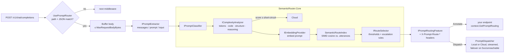

# SemanticRouter.NET

[](https://github.com/siebe41/SemanticRouter.NET/actions/workflows/ci.yml)

A lightweight, high-performance **semantic prompt router** for .NET 9 and ASP.NET Core.

It sends each incoming prompt to either a **fast local model** (Ollama, vLLM, LM Studio running a small language model) or an **advanced cloud model** (Claude, GPT, Gemini, …). The decision combines **cosine similarity against configured intent clusters** with **cheap structural complexity heuristics**. Easy prompts stay local and cost nothing. Hard prompts, and prompts that would overflow the local context window, go to the frontier model. Data-sensitive intents can be **pinned** so they never leave your infrastructure.

```text
"hello, how are you?"                         → Local   smalltalk          (similarity 0.73)
"summarize this email in two bullet points"   → Local   rewrite-summarize  (similarity 0.45)
"compare event sourcing and CRUD trade-offs"  → Cloud   deep-reasoning     (similarity 0.76)
"summarize this, then analyze step by step…"  → Cloud   ComplexityEscalation (matched a local route, complexity 0.74)
"look up the customer record for account 44"  → Local   internal-records   (pinned: never escalated or failed over)
"what is the capital of France?"              → Cloud   NoMatchFallback
```

---

## Contents

- [Features](#features)
- [Architecture](#architecture)
- [Routing strategy](#routing-strategy)
- [Quick start](#quick-start)
- [Using it in your application](#using-it-in-your-application)
- [Configuration reference](#configuration-reference)
- [Production guidance](#production-guidance)
- [Extensibility](#extensibility)
- [Building and testing](#building-and-testing)

---

## Features

- **Zero-dependency core.** `SemanticRouter.Core` references no NuGet packages. The vector math is hand-written SIMD over `ReadOnlySpan<float>` using `System.Numerics.Vector<T>`, which the JIT lowers to AVX-512, AVX2, SSE or Arm64 AdvSimd as available. It is marked AOT compatible.
- **Fast hot path.** Route utterances are embedded once, in one batch, and stored pre-normalized in a single contiguous matrix. Scoring a prompt costs one embedding call plus a sweep of dot products. Complexity analysis is one allocation-light pass with no regular expressions.
- **Explainable decisions.** Every result carries a `RoutingReason`, the matched route, its similarity, the top candidates and the individual complexity signals. They are exposed as response headers, structured logs, metrics and a diagnostics endpoint.
- **Two middleware modes.** **Annotate** attaches the decision to the request so your endpoint picks a client. **Dispatch** proxies the request to the selected upstream and streams the response back, including server-sent events.
- **Safety rails.** Pinned routes, fail-open classification, local→cloud failover, a context-window guard, ambiguity escalation, body size limits and validation at startup.
- **Pluggable.** You can replace `IEmbeddingProvider`, `IComplexityAnalyzer`, `IRouteSelector`, `IPromptClassifier` and `IPromptExtractor` through DI.
- **Batteries included.** It ships with an OpenAI-compatible embeddings client (Ollama, OpenAI, Azure OpenAI, vLLM, TEI, …) and a deterministic in-memory hashing provider for tests and offline development.

## Architecture

```text
SemanticRouter.NET
├── src/
│   ├── SemanticRouter.Core          # net9.0, zero dependencies
│   │   ├── Routing/                 # RouteDefinition, RouteTarget, RoutingReason, RouteScore,
│   │   │                            # RouteDecision, PromptClassificationResult, IRouteSelector
│   │   ├── Vectors/                 # VectorMath: SIMD Dot / Norm / CosineSimilarity / Normalize
│   │   ├── Heuristics/              # TokenEstimator, IComplexityAnalyzer, HeuristicComplexityAnalyzer
│   │   ├── Embeddings/              # IEmbeddingProvider, HashingEmbeddingProvider (mock / dev)
│   │   ├── Classification/          # IPromptClassifier, SemanticPromptClassifier,
│   │   │                            # SemanticRouteIndex, DefaultRouteSelector
│   │   └── SemanticRouterOptions.cs
│   └── SemanticRouter.AspNetCore    # DI, middleware, dispatch, OpenAI-compatible embeddings, metrics
├── samples/RoutingApiSample         # Minimal API configured entirely from appsettings.json
└── tests/SemanticRouter.Tests       # xUnit + FluentAssertions + Moq + TestHost (137 tests)
```

### Request flow



### Core abstractions

| Interface | Responsibility | Default |
|---|---|---|
| `IEmbeddingProvider` | Text → vector, single and batch | `HashingEmbeddingProvider` (dev), `OpenAICompatibleEmbeddingProvider` |
| `IComplexityAnalyzer` | Prompt → `ComplexityAnalysis` (pure, synchronous, cheap) | `HeuristicComplexityAnalyzer` |
| `IRouteSelector` | Ranked `RouteScore`s + complexity → `RouteDecision` (pure policy) | `DefaultRouteSelector` |
| `IPromptClassifier` | Orchestrates the above → `PromptClassificationResult` | `SemanticPromptClassifier` |
| `IPromptExtractor` *(AspNetCore)* | JSON body → prompt text | `JsonPromptExtractor` |

The split is deliberate. The selector is a pure function you can unit-test in isolation. The analyzer runs before any I/O. Only the classifier awaits anything.

## Routing strategy

### 1. Semantic matching

Each `RouteDefinition` is an intent cluster: a name, a `Target` (`Local` or `Cloud`) and a list of example **utterances**. At startup (or on the first request) every utterance is embedded in a single batch call. The vectors are L2-normalized into one row-major `float[]`, so for a prompt embedding **q**:

```text
similarity(route) = max over utterances u of  dot(u, q) / ‖q‖        (MaxSimilarity, default)
similarity(route) = dot(normalize(mean(u)), q) / ‖q‖                 (Centroid)
```

`MaxSimilarity` (nearest neighbour) is robust for heterogeneous intents. `Centroid` makes one comparison per route and suits tight clusters. The query norm is computed once, so each comparison is a single fused SIMD dot product.

### 2. Complexity heuristics

`HeuristicComplexityAnalyzer` extracts four signals in [0, 1] in a single line-oriented pass:

| Signal | What it measures |
|---|---|
| **Length** | `sqrt(min(1, estimatedTokens / TokenSaturation))`. Tokens come from a BPE-like estimate: about one token per word plus one per 6 extra characters, one per symbol run, and one per CJK character. |
| **Code** | Fenced code blocks (```` ``` ````/`~~~`), or a run of code-like lines (ending in `;` `{` `}`, containing `=>`, `::`, starting with `def `, `public `, `SELECT `, …). |
| **Structure** | Bullet and numbered list items, markdown headings, multiple questions, and many lines. |
| **Reasoning** | Distinct whole-word matches of phrases such as *step by step*, *trade-offs*, *analyze*, *prove*, *root cause* and *threat model* (configurable). |

The signals are combined with a **noisy-OR**, where each weight is the maximum contribution of its signal:

```text
score = 1 − (1 − wLength·length)(1 − wCode·code)(1 − wStructure·structure)(1 − wReasoning·reasoning)
```

One strong signal can push a prompt toward the cloud on its own. Several moderate signals reinforce each other, and the score never exceeds 1. Every intermediate signal is reported, so tuning is driven by data rather than guesswork.

### 3. Decision policy (`DefaultRouteSelector`)

Applied in order:

| # | Condition | Result | `RoutingReason` |
|---|---|---|---|
| 0 | Prompt empty | `FallbackTarget` | `EmptyPrompt` |
| 0 | `complexity ≥ ComplexityShortCircuitThreshold` *(skipped while any route is pinned)* | Cloud, **no embedding call** | `ComplexityShortCircuit` |
| 1 | Best similarity < route threshold (`SimilarityThreshold ?? DefaultSimilarityThreshold`) | `FallbackTarget` (escalated by rules 3–4 if that is Local) | `NoMatchFallback` |
| 2 | Best route targets Cloud, **or** is pinned (`AllowEscalation: false`) | That route | `SemanticMatch` |
| 3 | Local match, `estimatedTokens > LocalMaxPromptTokens` | Cloud | `ContextWindowEscalation` |
| 4 | Local match, `complexity ≥ ComplexityEscalationThreshold` | Cloud | `ComplexityEscalation` |
| 5 | Local match beats a *matching* Cloud route by `< AmbiguityMargin` | That Cloud route | `AmbiguousMatchEscalation` |
| 6 | Otherwise | The local route | `SemanticMatch` |
| – | Classifier threw and `FailOpen` is on *(middleware)* | `FallbackTarget` | `ClassifierFailure` |

Escalation is **one-way**: the policy never downgrades a cloud decision to local. When unsure, the router pays for quality rather than risk a bad answer.

### Choosing thresholds

Similarity distributions depend heavily on the embedding model. These are rough starting points only; always calibrate with the diagnostics endpoint:

| Embedding model | Starting `DefaultSimilarityThreshold` |
|---|---|
| `HashingEmbeddingProvider` (lexical, dev only) | 0.25 – 0.35 (the sample uses 0.30) |
| `nomic-embed-text` (Ollama) | 0.60 – 0.70 |
| `mxbai-embed-large` (Ollama) | 0.65 – 0.75 |
| OpenAI `text-embedding-3-small/large` | 0.40 – 0.55 |

To calibrate: collect 50–100 real prompts per intent and POST them to `/semantic-router/classify`. Look at the `candidates` similarities, then place each route's threshold between the in-intent scores and the best out-of-intent score. Prefer **more, more varied utterances** over lower thresholds.

## Quick start

Prerequisite: the [.NET 9 SDK](https://dotnet.microsoft.com/download/dotnet/9.0).

```bash
git clone https://github.com/siebe41/SemanticRouter.NET.git
cd SemanticRouter.NET
dotnet test
dotnet run --project samples/RoutingApiSample --launch-profile annotate
```

The sample starts in **Annotate** mode with the in-memory hashing embeddings, so it needs no model or API key:

```bash
curl -si http://localhost:5080/v1/chat/completions \
  -H 'Content-Type: application/json' \
  -d '{"model":"auto","messages":[{"role":"user","content":"hello, how are you today?"}]}'
```

```http
HTTP/1.1 200 OK
X-Prompt-Route: smalltalk
X-Prompt-Route-Target: Local
X-Prompt-Route-Reason: SemanticMatch
X-Prompt-Route-Complexity: 0.035
X-Prompt-Route-Similarity: 0.7305

{"id":"chatcmpl-…","model":"local-slm","choices":[…],"x_routing":{"target":"Local","reason":"SemanticMatch","route":"smalltalk",…}}
```

Inspect a full decision:

```bash
curl -s http://localhost:5080/semantic-router/classify \
  -H 'Content-Type: application/json' \
  -d '{"prompt":"why does this async code deadlock when I call .Result?"}'
```

`samples/RoutingApiSample/RoutingApiSample.http` has ready-made requests for every routing outcome.

### Dispatch mode with Ollama

```bash
ollama pull nomic-embed-text && ollama pull llama3.2
dotnet user-secrets --project samples/RoutingApiSample set "SemanticRouter:Endpoints:Cloud:ApiKey" "<your key>"
dotnet run --project samples/RoutingApiSample --launch-profile dispatch
```

The `dispatch` profile loads `appsettings.Dispatch.json`. That file switches to Ollama embeddings and proxies `/v1/chat/completions` to Ollama or the cloud endpoint, streaming tokens straight through.

## Using it in your application

```bash
dotnet add package SemanticRouter.AspNetCore   # brings SemanticRouter.Core
```

### Annotate mode: your endpoint chooses the client

```csharp
var builder = WebApplication.CreateBuilder(args);

builder.Services.AddSemanticPromptRouting(builder.Configuration.GetSection("SemanticRouter"));
builder.Services.AddKeyedSingleton<IChatClient>(RouteTarget.Local, /* Ollama client */);
builder.Services.AddKeyedSingleton<IChatClient>(RouteTarget.Cloud, /* frontier client */);

var app = builder.Build();
app.UsePromptRouter();

app.MapPost("/chat", async (ChatRequest request, HttpContext context, IServiceProvider services) =>
{
    PromptClassificationResult? routing = context.GetPromptRouting();
    var client = services.GetRequiredKeyedService<IChatClient>(routing?.Target ?? RouteTarget.Cloud);
    return await client.CompleteAsync(request);
});

app.Run();
```

### Dispatch mode: the middleware is the gateway

```json
"SemanticRouter": {
  "Middleware": { "Mode": "Dispatch", "PathPrefixes": [ "/v1/chat/completions" ] },
  "Endpoints": {
    "Local": { "BaseAddress": "http://localhost:11434", "Model": "llama3.2" },
    "Cloud": { "BaseAddress": "https://api.anthropic.com", "RequestPath": "/v1/chat/completions", "Model": "claude-sonnet-5-5" }
  }
}
```

The JSON body is forwarded unchanged except for `model`, so both upstreams must speak the same protocol. OpenAI-compatible `/v1/chat/completions` is the common denominator: Ollama, vLLM, LM Studio, OpenAI, Azure OpenAI, Anthropic's OpenAI-compatibility endpoint and most gateways (LiteLLM, OpenRouter) accept it. Response status, headers and body are streamed back. Hop-by-hop headers are stripped. The client's own `Authorization` header is **never** forwarded; credentials come from configuration.

### Code-first configuration

```csharp
builder.Services
    .AddSemanticPromptRouting(o =>
    {
        o.DefaultSimilarityThreshold = 0.65f;
        o.Routes.Add(new RouteDefinition
        {
            Name = "smalltalk",
            Target = RouteTarget.Local,
            Utterances = { "hi", "thanks!", "how are you?" },
        });
    })
    .UseOpenAICompatibleEmbeddings(e =>
    {
        e.Endpoint = new Uri("http://localhost:11434");
        e.Model = "nomic-embed-text";
    })
    .ConfigureMiddleware(m => m.PathPrefixes.Add("/v1/chat"));
```

### Core only (console apps, workers, Semantic Kernel filters, …)

```csharp
var options = new SemanticRouterOptions { DefaultSimilarityThreshold = 0.3f };
options.Routes.Add(new RouteDefinition { Name = "summarize", Target = RouteTarget.Local, Utterances = { "summarize this article" } });

var classifier = new SemanticPromptClassifier(new HashingEmbeddingProvider(), options);
await classifier.WarmUpAsync();

PromptClassificationResult result = await classifier.ClassifyAsync("please summarize this article about Rust");
// result.Target == RouteTarget.Local, result.RouteName == "summarize"
```

## Configuration reference

Everything binds from the `SemanticRouter` section. See `samples/RoutingApiSample/appsettings.json` for a complete annotated example.

### `SemanticRouter`

| Key | Default | Description |
|---|---|---|
| `Routes[]` | `[]` | Intent clusters (see below). |
| `DefaultSimilarityThreshold` | `0.75` | Minimum cosine similarity for a route without its own threshold. |
| `FallbackTarget` | `Cloud` | Target when nothing matches or classification fails. |
| `ComplexityEscalationThreshold` | `0.65` | Local-bound prompts at or above this score go to Cloud. Set above 1 to disable. |
| `ComplexityShortCircuitThreshold` | `0.9` | Skip embedding and go straight to Cloud. Set above 1 to disable. Ignored while any route is pinned. |
| `LocalMaxPromptTokens` | `4096` | Context-window guard for the local model. `0` disables it. |
| `AmbiguityMargin` | `0.02` | Prefer a matching cloud route that lost to a local route by less than this margin. `0` disables it. |
| `ScoringStrategy` | `MaxSimilarity` | `MaxSimilarity` or `Centroid`. |
| `MaxReportedScores` | `3` | Candidates included in results and diagnostics. |
| `Complexity:TokenSaturation` | `2048` | Token count at which the length signal reaches 1. |
| `Complexity:{Length,Code,Structure,Reasoning}Weight` | `0.6/0.6/0.5/0.6` | Maximum contribution of each signal (0–1). |
| `Complexity:ReasoningKeywordSaturation` | `3` | Distinct keyword hits for a full reasoning signal. |
| `Complexity:ReasoningKeywords` | built-in list | Replaces (does not extend) the default keyword list. |

### `SemanticRouter:Routes[]`

| Key | Default | Description |
|---|---|---|
| `Name` | – | Unique (case-insensitive). Emitted in headers, logs and metrics. |
| `Target` | `Local` | `Local` or `Cloud`. |
| `Utterances[]` | – | Representative prompts. Aim for 5–20 diverse examples. |
| `SimilarityThreshold` | `null` | Per-route override. |
| `AllowEscalation` | `true` | `false` **pins** the route: no complexity, context, ambiguity or failover escalation. |
| `Description` | `null` | Documentation only. |

### `SemanticRouter:Embeddings`

| Key | Default | Description |
|---|---|---|
| `Provider` | `Hashing` | `Hashing` or `OpenAICompatible`. Ignored if you register your own `IEmbeddingProvider`. |
| `Dimensions` | `512` | Hashing provider vector size. |
| `Endpoint`, `RequestPath` | –, `/v1/embeddings` | OpenAI-compatible server. |
| `Model`, `ApiKey` | – | Embedding model name and optional bearer token. |
| `MaxBatchSize` | `64` | Utterances per indexing call. |
| `Timeout` | `00:00:10` | Per-call timeout. This is on the hot path, so keep it short. |
| `WarmUpOnStartup` | `true` | Build the route index in the background at startup. |

### `SemanticRouter:Middleware`

| Key | Default | Description |
|---|---|---|
| `Mode` | `Annotate` | `Annotate` or `Dispatch`. |
| `PathPrefixes[]` | `[]` (all JSON POSTs) | Segment-aware, case-insensitive. **Required** in Dispatch mode. |
| `MaxRequestBodyBytes` | `1048576` | Larger bodies are rejected with 413. |
| `EmitResponseHeaders` | `true` | Emits `X-Prompt-Route`, `-Target`, `-Reason`, `-Similarity`, `-Complexity` and `-Failover`. |
| `HeaderPrefix` | `X-Prompt-Route` | Header name prefix. |
| `FailOpen` | `true` | On classifier failure, use `FallbackTarget` instead of failing the request. |
| `FailoverToCloud` | `true` | In Dispatch mode, retry on Cloud when Local is unreachable, times out or returns 5xx. Never applies to pinned routes. |
| `MessageSelection` | `LastUserMessage` | `LastUserMessage`, `AllUserMessages` or `AllMessages`. |

### `SemanticRouter:Endpoints:{Local|Cloud}` (Dispatch mode)

| Key | Default | Description |
|---|---|---|
| `BaseAddress` | – | Absolute URI. Required in Dispatch mode. |
| `RequestPath` | incoming path + query | Upstream path. |
| `Model` | `null` | Overwrites the body's top-level `model`. |
| `ApiKey` | `null` | Sent as `Authorization: Bearer …`. |
| `Headers` | `{}` | Extra upstream headers (e.g. `x-api-key`, `anthropic-version`, Azure `api-key`). |
| `Timeout` | `00:01:40` | Time until upstream response headers arrive. Streamed bodies are not time-limited. |

## Production guidance

- **Use a real embedding model.** `HashingEmbeddingProvider` captures only lexical overlap. It cannot tell that "I forgot my login" and "reset my password" mean the same thing. Run a small local embedder such as `nomic-embed-text` (fast, free, and private) next to your local chat model.
- **Fail-safe defaults.** With `FallbackTarget: Cloud`, `FailOpen: true` and one-way escalation, an outage or misconfiguration costs money, not answer quality. Invert `FallbackTarget` only if cost matters more than quality.
- **Privacy.** Mark data-sensitive intents `AllowEscalation: false`. Pinned routes are exempt from complexity short-circuiting, escalation and failover, so a matching prompt never leaves your network. Remember that a prompt that *fails to match* a pinned route goes to `FallbackTarget`. For strict data-residency requirements, set `FallbackTarget: Local` as well.
- **Secrets.** Never put API keys in `appsettings.json`. Use user-secrets, environment variables (`SemanticRouter__Endpoints__Cloud__ApiKey`) or a vault provider.
- **Pipeline placement.** Call `UsePromptRouter()` after authentication, authorization and rate limiting, so anonymous traffic cannot drive embedding calls.
- **Diagnostics.** `MapPromptClassification()` exposes routing internals. Protect it (`.RequireAuthorization(...)`) or map it only in development. Set `EmitResponseHeaders: false` if clients should not see routing decisions.
- **Resilience.** The dispatch and embedding `HttpClient`s are named clients (`SemanticRouter.Local`, `SemanticRouter.Cloud`, `SemanticRouter.Embeddings`). Add retries or circuit breakers with `Microsoft.Extensions.Http.Resilience`:
  ```csharp
  builder.Services.AddHttpClient("SemanticRouter.Embeddings").AddStandardResilienceHandler();
  ```
- **Telemetry.** Metrics are published on the `SemanticRouter` meter:
  - `semantic_router.decisions`: counter tagged `target`, `reason` and `route`.
  - `semantic_router.classification.duration`: histogram in seconds.
  - `semantic_router.failovers`: counter.

  Wire them up with `metrics.AddMeter(SemanticRouterDiagnostics.MeterName)`. Every decision is also logged at `Information` with route, similarity, complexity and latency.
- **Startup.** Routing options are validated at startup (`ValidateOnStart`), and invalid Dispatch configuration fails fast. The route index is built in the background. If the embedding server is down at startup, the build is retried on the first request instead of crashing the host.

### Known limitations

- Routes are read once at startup. `IOptionsMonitor` reloads do not rebuild the index; restart to pick up changes.
- Dispatch forwards one wire protocol. For providers with different native APIs, use Annotate mode with per-target clients, or put a protocol-translating gateway in front.
- Token counts are tokenizer-free estimates, approximating GPT-style BPE for English prose and code. Leave headroom in `LocalMaxPromptTokens`.

## Extensibility

| To… | Do this |
|---|---|
| Use another embedding backend (ONNX, Azure AI, `Microsoft.Extensions.AI`) | Implement `IEmbeddingProvider` and call `.UseEmbeddingProvider<T>()`. |
| Change the routing policy (cost budgets, tenant tiers, time of day) | Implement `IRouteSelector` and register it before `AddSemanticPromptRouting()`. Registrations use `TryAdd`. |
| Add complexity signals (language detection, attachments) | Implement or decorate `IComplexityAnalyzer`. |
| Support a custom payload shape | Implement `IPromptExtractor`. You get the parsed `JsonElement` and the `HttpContext`. |
| Cache prompt embeddings | Decorate `IEmbeddingProvider` (e.g. with `HybridCache`). |

## Building and testing

```bash
dotnet build                      # warnings are errors; .NET analyzers at latest-recommended
dotnet test                       # 137 tests: vector math, heuristics, index, policy, classifier,
                                  # extractor, embeddings client, config binding, middleware + dispatch (TestHost)
dotnet pack -c Release -o artifacts
```

The test stack is xUnit, FluentAssertions 7.x (the last Apache-2.0 licensed line) and Moq. ASP.NET Core behaviour is tested in-process with `Microsoft.AspNetCore.TestHost` and stub `HttpMessageHandler`s, so no network or model is required.

## License

[MIT](LICENSE)
