# SemanticRouter.NET

[](https://github.com/siebe41/SemanticRouter.NET/actions/workflows/ci.yml)

A lightweight **semantic prompt router** for .NET 9 and ASP.NET Core. It sends every prompt to the **cheapest model that is capable enough to answer it**, choosing across:

- **local models** (LM Studio, Ollama, vLLM),
- **your own subscription CLIs** (Claude Code, GitHub Copilot CLI, Codex CLI),
- **paid APIs** (OpenAI, Anthropic, Gemini, Azure OpenAI, OpenRouter, …).

When a subscription hits its usage limit, the router cools that model down and moves on to the next-best one automatically.

It speaks **both the OpenAI and the Anthropic protocol**, so you can point **Claude Code**, Codex CLI, the OpenAI SDKs or any chat tool at it and keep working exactly as before: the tool keeps its own model names and its agentic loop, and the router decides which backend answers each turn. A built-in **dashboard** shows live activity and lets you edit every setting, with hot reload.


It decides in two steps:

1. **What does this prompt need?** Embedding similarity against your intent clusters, plus cheap structural complexity heuristics, produce a required **capability tier**, required **capabilities** (`code`, `tools`, `vision`, …) and an optional **local-only** constraint.
2. **Which model should answer?** Your model catalog is ranked by a strategy: cheapest capable, most capable or your own priority. The router then tries the models in order through their connectors, failing over when a model is down or out of quota.

```text
prompt                                              needs                 → served by (LM Studio + Claude Code catalog)
"hello, how are you today?"                         tier 1                → lmstudio-small   (free, local)
"write a unit test for this function: …"            tier 2 + code         → lmstudio-coder   (free, local)
"compare event sourcing and CRUD trade-offs"        tier 4                → claude-code      (your subscription)
"summarize this, then analyze step by step…"        tier 1 → 3 by complexity → claude-code
"look up the customer record for account 4471"      tier 1, local only    → lmstudio-small   (never leaves the machine)
  … Claude session limit reached …                  tier 4                → lmstudio-coder   (best available; Claude cools down)
```

Two front doors: OpenAI-compatible (`POST /v1/chat/completions`, `GET /v1/models`) for any tool with a configurable base URL, and the Anthropic Messages API (`POST /v1/messages`) for Claude Code and the Anthropic SDKs. Send `"model": "auto"` and let the router choose, or keep the tool's own model names and map them with aliases.

---

## Contents

- [Features](#features)
- [How it works](#how-it-works)
- [Providers](#providers)
- [Quick start](#quick-start)
- [Personal setup: LM Studio + your Claude subscription](#personal-setup-lm-studio--your-claude-subscription)
- [Using Claude Code and other tools through the router](#using-claude-code-and-other-tools-through-the-router)
- [The dashboard](#the-dashboard)
- [Using it in your application](#using-it-in-your-application)
- [Configuration reference](#configuration-reference)
- [Production guidance](#production-guidance)
- [Extensibility](#extensibility)
- [Building and testing](#building-and-testing)
- [Roadmap](#roadmap)

Also see the [documentation index](docs/README.md): [clients.md](docs/clients.md) (pointing Claude Code, Codex and SDKs at the router), [dashboard.md](docs/dashboard.md) (the UI and admin API), [providers.md](docs/providers.md) (connector setup per provider), [architecture.md](docs/architecture.md) (how a request flows, hot reload, extension points), [roadmap.md](docs/roadmap.md) (where the project is going) and [TERMS.md](docs/TERMS.md) (why the subscription CLI connectors are designed the way they are, and where the lines are).

---

## Features

- **Two protocols in, every backend out.** OpenAI chat completions and the Anthropic Messages API are both accepted; requests and replies are translated between them, including streaming, images and tool calls, and passed through untouched when client and backend speak the same protocol.
- **Built for agentic clients.** Point Claude Code or Codex at the router: their model names map through aliases, their tool-bearing turns go to tool-capable backends, the follow-up requests of a tool-calling turn stay on the model that started it, injected `<system-reminder>` blocks are ignored when classifying, and `count_tokens` is served locally. A CLI connector can even carry tools for them (*prompted tool calling*), so your Claude subscription can answer agentic turns.
- **A dashboard with hot reload.** Live status, cooldowns, an activity log with every decision, a prompt tester, and an editor for routes, models, connectors, tiers, routing rules, embeddings and gateway settings. Apply changes to the running router, save them to a file, or revert. Themeable (Machine Dark by default).
- **Named tiers.** The capability ladder is explicit configuration (`Tiers`), shown everywhere a tier appears, with a matrix of which routes need each rung and which models provide it.
- **Capability-aware, cost-aware routing.** Routes declare the tier and capabilities an intent needs. Models declare their tier, capabilities, context window, cost and priority. The selector picks the cheapest model that qualifies, the most capable one, or follows your priority order, and clients can choose per request (`auto:cheapest`, `auto:best`, `auto:priority`).
- **Every kind of provider.** There is an OpenAI-compatible HTTP connector for local servers and APIs, a CLI connector that runs Claude Code, Copilot CLI or Codex CLI on your own login, and an `IChatConnector` interface for anything else.
- **Automatic failover and quota cooldowns.** A model that is unreachable, times out, returns 5xx/429 or reports a usage limit is skipped for a cooldown period. An account-wide subscription limit cools down every model on that account at once.
- **Privacy rails.** Routes marked `LocalOnly` can only be served by models marked `IsLocal`, even on failover. Subscription CLI connectors refuse requests from other machines by default.
- **Zero-dependency core.** `SemanticRouter.Core` references no NuGet packages. It has SIMD cosine similarity over `ReadOnlySpan<float>` (`System.Numerics.Vector<T>`), a tokenizer-free token estimator, complexity heuristics, and the route and model selectors. It is AOT-compatible.
- **Explainable decisions.** Every decision carries a reason, a tier, route similarities, complexity signals and the ranked model list. These are exposed through `X-Prompt-Route-*` headers, structured logs, metrics and a diagnostics endpoint.
- **Two middleware modes.** **Dispatch** serves requests through the connectors and streams the reply back. **Annotate** only attaches the routing plan, so your own endpoint makes the call.

## How it works

```mermaid
flowchart LR
    A1[POST /v1/messages<br/>Claude Code · Anthropic SDKs] --> B
    A2[POST /v1/chat/completions<br/>OpenAI SDKs · Codex · chat UIs] --> B
    B[UsePromptRouter<br/>parse · map model name · pin tool turns] --> C[IPromptExtractor<br/>latest human message]
    subgraph Core [SemanticRouter.Core]
        C --> D[IComplexityAnalyzer<br/>length · code · structure · reasoning]
        D --> E[IEmbeddingProvider +<br/>SemanticRouteIndex<br/>SIMD cosine vs. utterances]
        E --> F[IRouteSelector<br/>→ tier, capabilities, local-only]
        F --> G[IModelSelector<br/>rank catalog by strategy<br/>skip cooled-down models]
    end
    G --> H{Mode}
    H -- "Annotate" --> I[your endpoint<br/>context.GetPromptRouting]
    H -- "Dispatch" --> J[PromptDispatcher<br/>try candidates in order]
    J --> K[HTTP: OpenAI-compatible or Anthropic<br/>LM Studio · Ollama · OpenAI · Anthropic · Gemini …]
    J --> L[CLI<br/>Claude Code · Copilot CLI · Codex CLI · custom]
    K --> M[Reply in the client's protocol<br/>JSON or SSE · tool calls]
    L --> M
```



The classifier, router, connectors and extractor are rebuilt as one unit when configuration changes, so edits from the dashboard apply without a restart. [docs/architecture.md](docs/architecture.md) walks through a request step by step.

### Step 1: requirements from the prompt

**Semantic matching.** Each route is an intent cluster: example utterances plus the `Tier` (and optionally `RequiredCapabilities` and `LocalOnly`) that intent needs. Utterances are embedded once, in a batch, and stored L2-normalized in one contiguous matrix. Scoring a prompt costs one embedding call and a sweep of SIMD dot products (`MaxSimilarity` nearest neighbour, or `Centroid`).

**Complexity heuristics.** A single pass extracts four signals in [0, 1]:

| Signal | Measures |
|---|---|
| Length | `sqrt(min(1, tokens / TokenSaturation))` from a BPE-like token estimate |
| Code | fenced code blocks, or runs of code-like lines |
| Structure | list items, headings, multiple questions, many lines |
| Reasoning | whole-word phrases such as *step by step*, *trade-offs*, *root cause*, *prove* |

These combine with a noisy-OR, `1 − Π(1 − weightᵢ·signalᵢ)`, so a single strong signal can raise the score on its own.

**Policy (`DefaultRouteSelector`).** Requirements only ever go **up**:

| Condition | Required tier | `RoutingReason` |
|---|---|---|
| Best route below its similarity threshold | `FallbackTier` (default 3) | `NoMatchFallback` |
| Route matched | the route's `Tier`, capabilities, `LocalOnly` | `SemanticMatch` |
| Other routes within `AmbiguityMargin` of the best | highest of their tiers; capabilities unioned; local-only is sticky | `AmbiguousMatchEscalation` |
| Complexity reaches a `ComplexityTiers` rule (default 0.45→2, 0.65→3, 0.85→4) | raised to that tier | `ComplexityEscalation` |
| Complexity ≥ `ComplexityShortCircuitThreshold` *(skipped while any route is local-only)* | tier from complexity alone, **no embedding call** | `ComplexityShortCircuit` |
| Request names a catalog model | that model only | `ModelOverride` |
| Classifier failed and `FailOpen` is on | `FallbackTier` | `ClassifierFailure` |

The request itself adds requirements. If it defines `tools`, the model must declare `tools`. If it contains images, the model must declare `vision`. The size of the whole conversation, including tool definitions, is checked against each model's `ContextWindow`.

### Step 2: choosing a model

A model is **eligible** when it is:
- enabled and not in cooldown,
- local, if the request is local-only,
- declares every required capability,
- has a context window that fits the request.

Eligible models that meet the required tier are ordered by the strategy:

| Strategy | Order | Use it when |
|---|---|---|
| `CheapestCapable` *(default)* | estimated cost ↑, then tier ↑, then `Priority` ↑ | you want the cheapest model that is good enough. Ties between free options (local models, flat-rate subscriptions) go to the **lowest sufficient tier**, saving premium quota for prompts that need it. |
| `MostCapable` | tier ↓, then cost ↑ | quality matters more than cost |
| `Priority` | your `Priority` ↑, then cost ↑ | you want explicit control |

With `AllowBelowRequiredTier` (the default), the remaining eligible models follow, most capable first. When every tier-4 model is out of quota, a hard prompt still gets the best answer available rather than an error.

**Failover.** In Dispatch mode the router tries up to `MaxAttempts` candidates. Failover is only possible **before** any output reaches the client; once tokens are streaming, that model owns the response. Failures put the model into cooldown:

| Failure | Cooldown |
|---|---|
| Unreachable, timeout, HTTP 401/403/404/408/5xx, CLI crash | `FailureCooldown` (30 s) |
| HTTP 429, a CLI usage-limit message ("You've hit your session limit", "usage limit", …) | `QuotaCooldown` (15 min) |
| Account-wide CLI limit (session/weekly) | every model on that connector |

`GET /v1/models` shows which models are cooling down and until when.

## Providers

| Provider | Connector | Billing | Notes |
|---|---|---|---|
| LM Studio, Ollama, vLLM, llama.cpp server | `OpenAICompatible` | free (local) | mark `IsLocal: true` |
| OpenAI, Azure OpenAI, OpenRouter, Groq, Mistral, LiteLLM | `OpenAICompatible` | per token (API key) | |
| Anthropic API | `OpenAICompatible` (Anthropic's OpenAI-compatible endpoint) | per token (API key) | |
| Google Gemini API | `OpenAICompatible` (`/v1beta/openai/chat/completions`) | per token (API key) | |
| **Claude Code CLI** | `Cli`, preset `ClaudeCode` | your Claude subscription | personal, local use; see [TERMS.md](docs/TERMS.md) |
| **GitHub Copilot CLI** | `Cli`, preset `GitHubCopilot` | your Copilot plan (AI credits) | personal, local use |
| **OpenAI Codex CLI** | `Cli`, preset `Codex` | your ChatGPT plan | personal, local use |
| Anything else with a CLI | `Cli`, preset `Custom` | – | argument template with `{model}`, `{prompt}` |
| Anything else | your own `IChatConnector` | – | |

Not included, on purpose:
- **GitHub Models API:** retired on 30 July 2026.
- **Gemini CLI on a Google login:** consumer login was shut off in June 2026, and Google's terms prohibit piggybacking on the CLI's OAuth. Use the Gemini API with a key instead.

[docs/providers.md](docs/providers.md) has setup steps for each provider.

## Quick start

Prerequisite: the [.NET 9 SDK](https://dotnet.microsoft.com/download/dotnet/9.0).

```bash
git clone https://github.com/siebe41/SemanticRouter.NET.git
cd SemanticRouter.NET
dotnet test
dotnet run --project samples/RoutingApiSample --launch-profile annotate
```

The sample starts in **Annotate** mode with in-memory hashing embeddings. It needs no model, CLI or key. Open the dashboard at <http://localhost:5080/router>, or ask it which model it *would* use:

```bash
curl -s http://localhost:5080/semantic-router/classify \
  -H 'Content-Type: application/json' \
  -d '{"prompt":"why does this async code deadlock when I call .Result?"}'
```

```json
{
  "requiredTier": 4, "reason": "SemanticMatch", "route": "complex-code", "similarity": 0.81,
  "localOnly": false, "requiredCapabilities": ["code"],
  "routes":  [{ "route": "complex-code", "tier": 4, "similarity": 0.81 }, …],
  "models":  [{ "model": "claude-code", "connector": "claude-cli", "tier": 4, "estimatedCostUsd": 0, "meetsRequiredTier": true },
              { "model": "claude-code-opus", … }, { "model": "lmstudio-coder", …, "meetsRequiredTier": false }],
  "complexity": { "score": 0.048, "estimatedTokens": 13, … }
}
```

`samples/RoutingApiSample/RoutingApiSample.http` has a request for every routing outcome.

## Personal setup: LM Studio + your Claude subscription

> **Start here:** [`samples/LmStudioClaudePoc`](samples/LmStudioClaudePoc/README.md) is a ready-to-run proof of concept for exactly this setup. Run `dotnet run --project samples/LmStudioClaudePoc -- --demo`; it checks both backends, then shows prompts being routed live.

This is the "use local models for the easy stuff, my subscription for the hard stuff" configuration.

1. **LM Studio.** Load a small chat model, a coder model and an embedding model (e.g. `text-embedding-nomic-embed-text-v1.5`), then start the server on port 1234. Check the exact model IDs with `curl http://localhost:1234/v1/models` and put them in `appsettings.json` (`Models[].Model`, `Embeddings:Model`).
2. **Claude Code.** Install it and sign in once by running `claude` and using `/login`. The router never sees your credentials: it runs the `claude` binary, which uses its own login.
3. **Run the router.**
   ```bash
   dotnet run --project samples/RoutingApiSample --launch-profile dispatch
   ```
4. **Point your tools at it.** Base URL `http://localhost:5080/v1`, any API key, and model `auto`:
   ```bash
   curl -N http://localhost:5080/v1/chat/completions -H 'Content-Type: application/json' \
     -d '{"model":"auto","stream":true,"messages":[{"role":"user","content":"Compare event sourcing and CRUD"}]}'
   ```

5. **Or point Claude Code at it** and keep using Claude Code as before:
   ```bash
   ANTHROPIC_BASE_URL=http://localhost:5080 ANTHROPIC_AUTH_TOKEN=semantic-router claude
   ```
   See [Using Claude Code and other tools through the router](#using-claude-code-and-other-tools-through-the-router).

Enable `copilot`, `codex` or the paid API models in `appsettings.json` or the dashboard as you need them. With `CheapestCapable`:
- free local models answer whatever they are good enough for;
- flat-rate subscriptions take the hard prompts;
- paid APIs are used only when nothing cheaper qualifies (for example, a request with `tools` or images, which CLI connectors cannot handle) or when everything cheaper is cooling down.

## Using Claude Code and other tools through the router

The router is a drop-in base URL. Claude Code speaks the Anthropic Messages API, so:

```bash
export ANTHROPIC_BASE_URL=http://localhost:5080
export ANTHROPIC_AUTH_TOKEN=semantic-router   # any value; the router never reads or forwards it
claude
```

Nothing about your workflow changes. Claude Code keeps its system prompt, its tools and its model names; the router decides per turn:

| Claude Code sends… | The router… |
|---|---|
| `claude-sonnet-…`, `/model opus`, `haiku` for side tasks | maps the name through `Middleware:ModelAliases` (`*haiku*` → `auto:cheapest`, `*opus*` → `auto:best`, …); unknown names route as `auto`, catalog names force that model |
| a turn with tools (every main-loop turn) | requires `tools`: HTTP models declaring it (a local coder model, an API-key model) or a CLI connector with `ToolCalling: Prompted` |
| tool results (the loop continuing) | pins the request to the model that issued the tool calls (`ConversationAffinity`) |
| `<system-reminder>` blocks, `count_tokens` calls | ignores the former when classifying; answers the latter from its own estimator |

**Where agentic turns can go.** A tool-bearing turn needs a backend that carries tools: an OpenAI-compatible model with function calling (LM Studio or Ollama with `qwen3-coder`, vLLM, OpenRouter, OpenAI), an `Anthropic` connector (API key, requests pass through untouched), or a CLI connector with **prompted tool calling**: the tools are described in the prompt, the model answers with a fenced `tool_call` block, the router turns it into a real `tool_use`, and Claude Code runs the tool as usual. The subscription stays text-in/text-out; it costs more quota than native use because every turn re-sends the context. Details, limits and snippets for Codex, the OpenAI SDKs, Aider and curl: [docs/clients.md](docs/clients.md).

## The dashboard

```csharp
app.MapRouterDashboard("/router");   // UI at /router, admin API under /router/api (loopback only unless a token is set)
builder.Services.AddSemanticPromptRouting(config).UseConfigurationFile("semantic-router.json");   // optional: persist changes
```

Overview (models and cooldowns, served-by and required-tier charts, a prompt tester), Activity (every routed request with its decision and outcome), and editors for Tiers, Routes, Models, Connectors, Routing rules, Embeddings and Gateway. **Validate** → **Apply** swaps a new runtime in atomically; **Apply & save** also writes the configuration file, which replaces the `SemanticRouter` section on the next start (secrets left empty are inherited from it). The admin API behind it takes the same JSON document, so a tested configuration can be promoted with one `PUT`. Themes are CSS token blocks; adding one is a block in `app.css` plus an entry in `app.js`. See [docs/dashboard.md](docs/dashboard.md).

## Using it in your application

### Dispatch mode: the router is your gateway

```csharp
var builder = WebApplication.CreateBuilder(args);
builder.Services.AddSemanticPromptRouting(builder.Configuration.GetSection("SemanticRouter"));

var app = builder.Build();
app.UsePromptRouter();          // serves POST /v1/chat/completions and POST /v1/messages (Middleware:PathPrefixes / AnthropicPathPrefixes)
app.MapRouterModels();          // GET /v1/models
app.MapAnthropicTokenCount();   // POST /v1/messages/count_tokens
app.MapRouterDashboard();       // the dashboard and admin API at /router
app.Run();
```

**HTTP connectors** forward the original body untouched apart from `model` when the client speaks their protocol, so tool calls, images and SSE pass straight through; otherwise they translate the request and the reply (JSON or SSE) between the OpenAI and Anthropic formats. The client's own `Authorization`/`x-api-key` headers are never forwarded; credentials come from configuration.

**CLI connectors** turn the conversation into a prompt, run the CLI with its tools disabled, and return a reply in the client's protocol (`chat.completion` or an Anthropic `message`, streamed when asked). With `ToolCalling: Prompted` they also carry the client's tools.

### Annotate mode: your endpoint makes the call

```csharp
app.UsePromptRouter();

app.MapPost("/chat", async (ChatRequest request, HttpContext context, MyClients clients) =>
{
    RoutingPlan plan = context.GetPromptRouting()!;
    ModelDefinition model = plan.Candidates[0].Model;     // best model; the rest are fallbacks
    return await clients.For(model.Connector).CompleteAsync(model.Model, request);
});
```

### Code-first configuration

```csharp
builder.Services
    .AddSemanticPromptRouting(o =>
    {
        o.DefaultSimilarityThreshold = 0.65f;
        o.Routes.Add(new RouteDefinition { Name = "smalltalk", Tier = 1, Utterances = { "hi", "thanks!", "how are you?" } });
        o.Routes.Add(new RouteDefinition { Name = "design", Tier = 4, Utterances = { "design a scalable architecture" } });
    })
    .AddConnector("lmstudio", c => c.BaseAddress = new Uri("http://localhost:1234"))
    .AddConnector("claude-cli", c => { c.Type = ConnectorType.Cli; c.Preset = CliPreset.ClaudeCode; })
    .AddModel(new ModelDefinition { Name = "local", Connector = "lmstudio", Model = "qwen/qwen3-8b", Tier = 1, IsLocal = true })
    .AddModel(new ModelDefinition { Name = "claude", Connector = "claude-cli", Model = "sonnet", Tier = 4 })
    .UseOpenAICompatibleEmbeddings(e =>
    {
        e.Endpoint = new Uri("http://localhost:1234");
        e.Model = "text-embedding-nomic-embed-text-v1.5";
    })
    .ConfigureMiddleware(m => { m.Mode = PromptRouterMode.Dispatch; m.PathPrefixes.Add("/v1/chat/completions"); });
```

### Core only (console apps, workers, agent frameworks)

```csharp
var options = new SemanticRouterOptions { DefaultSimilarityThreshold = 0.3f };
options.Routes.Add(new RouteDefinition { Name = "summarize", Tier = 1, Utterances = { "summarize this article" } });
options.Models.Add(new ModelDefinition { Name = "local", Connector = "lmstudio", Tier = 1, IsLocal = true });
options.Models.Add(new ModelDefinition { Name = "frontier", Connector = "api", Tier = 4, InputCostPerMillionTokens = 3, OutputCostPerMillionTokens = 15 });

var router = new PromptRouter(new SemanticPromptClassifier(new HashingEmbeddingProvider(), options), options);
RoutingPlan plan = await router.RouteAsync(new PromptRoutingRequest { Prompt = "please summarize this article about Rust" });
// plan.Classification.RequiredTier == 1, plan.Candidates[0].Model.Name == "local"
```

## Configuration reference

Everything binds from the `SemanticRouter` section. `samples/RoutingApiSample/appsettings.json` is a complete annotated example.

### `SemanticRouter`

| Key | Default | Description |
|---|---|---|
| `Routes[]` | `[]` | Intent clusters (below). |
| `Models[]` | `[]` | The model catalog (below). |
| `Connectors:{name}` | `{}` | How to reach providers (below). |
| `Tiers[]` | 5 built-in levels | `{ Level, Name, Description }`: names for the tier numbers, shown by the dashboard and `/v1/models`. Routing compares the numbers. |
| `DefaultSimilarityThreshold` | `0.75` | Minimum cosine similarity for routes without their own threshold. |
| `FallbackTier` | `3` | Tier required when nothing matches or classification fails. |
| `ComplexityTiers[]` | 0.45→2, 0.65→3, 0.85→4 | `{ MinScore, Tier }` rules that raise the tier. An empty list disables them. |
| `ComplexityShortCircuitThreshold` | `0.9` | Skip embedding for obviously hard prompts. Set above 1 to disable. |
| `AmbiguityMargin` | `0.02` | Near-tied routes contribute their tier. `0` disables. |
| `ScoringStrategy` | `MaxSimilarity` | `MaxSimilarity` or `Centroid`. |
| `Complexity:*` | | `TokenSaturation`, `{Length,Code,Structure,Reasoning}Weight`, `ReasoningKeywords`, … |
| `Selection:Strategy` | `CheapestCapable` | `CheapestCapable`, `MostCapable` or `Priority`. |
| `Selection:AllowBelowRequiredTier` | `true` | Degrade to the best available model instead of failing. |
| `Selection:MaxAttempts` | `3` | Models tried per request. |
| `Selection:QuotaCooldown` / `FailureCooldown` | `00:15:00` / `00:00:30` | How long failed models are skipped. |
| `Selection:EstimatedOutputTokens` | `512` | Used for cost estimates and context-window checks. |

### `Routes[]`

| Key | Default | Description |
|---|---|---|
| `Name` | – | Unique. |
| `Tier` | `1` | Minimum model tier. Suggested scale: 1 small local · 2 mid/mini · 3 strong · 4 frontier · 5 frontier + deep reasoning. |
| `RequiredCapabilities[]` | `[]` | Tags the model must declare (e.g. `code`). |
| `Utterances[]` | – | 5–20 diverse examples. |
| `SimilarityThreshold` | `null` | Per-route override. |
| `LocalOnly` | `false` | Only `IsLocal` models may answer, even on failover. |

### `Models[]`

| Key | Default | Description |
|---|---|---|
| `Name` | – | Unique catalog name. Clients may request it directly as `model`. |
| `Connector` | – | Name of a configured connector. |
| `Model` | `null` | Provider model ID sent to the connector (e.g. `qwen/qwen3-8b`, `sonnet`, `gpt-6.1-sol`). |
| `Tier` | `1` | Capability tier. |
| `Capabilities[]` | `[]` | e.g. `chat`, `code`, `tools`, `vision`, `reasoning`. CLI-backed models should not declare `tools`. |
| `IsLocal` | `false` | Data stays on your machine. |
| `ContextWindow` | `0` (unknown) | Tokens. Models too small for a request are skipped. |
| `InputCostPerMillionTokens` / `OutputCostPerMillionTokens` | `0` | Marginal USD cost. Use 0 for local models and flat-rate subscriptions. |
| `Priority` | `0` | Lower is preferred. Breaks ties; primary key for the `Priority` strategy. |
| `Enabled` | `true` | |

### `Connectors:{name}`

| Key | Applies to | Default | Description |
|---|---|---|---|
| `Type` | all | `OpenAICompatible` | `OpenAICompatible`, `Anthropic` (Messages API) or `Cli`. |
| `BaseAddress`, `RequestPath` | HTTP | –, `/v1/chat/completions` (`/v1/messages` for Anthropic) | |
| `ApiKey`, `Headers` | HTTP | | Bearer token (`x-api-key` for Anthropic) and extra headers. Keep keys in user-secrets or environment variables, or write a reference: `"${env:OPENAI_API_KEY}"`, `"${secret:…}"`. |
| `ForwardHeaders[]` | HTTP | `[]` | Client request headers to relay upstream (e.g. `anthropic-beta`). Authorization headers never are. |
| `AnthropicVersion` | Anthropic | `2023-06-01` | Sent as `anthropic-version`. |
| `ToolCalling` | CLI | `None` | `None`: decline tool-bearing requests. `Prompted`: describe the tools in the prompt and parse `tool_call` blocks from the reply. |
| `Preset` | CLI | `Custom` | `ClaudeCode`, `GitHubCopilot`, `Codex` or `Custom`. |
| `Executable` | CLI | preset's command | Started directly, never through a shell. On Windows use the `.exe`. |
| `Arguments[]` | CLI | | Custom: the full template (`{model}`, `{prompt}`). Presets: extra arguments appended. |
| `PromptInput` | CLI (custom) | `Stdin` | `Stdin` or `Argument`. |
| `QuotaErrorPatterns[]` | CLI | preset patterns | Extra output fragments that mean "quota exhausted". |
| `EnvironmentVariables`, `RemoveEnvironmentVariables[]` | CLI | preset defaults | The presets remove API-key variables that would switch billing away from your subscription. |
| `MaxConcurrency` | CLI | `2` | Simultaneous processes. |
| `MaxArgumentLength` | CLI | `24000` | Longer prompts are sent on stdin. |
| `AllowRemoteClients` | CLI | `false` | See [TERMS.md](docs/TERMS.md) before changing this. |
| `Timeout` | all | HTTP 100 s · CLI 5 min | Time to first output. Streams are not cut off. |

### `Embeddings` and `Middleware`

| Key | Default | Description |
|---|---|---|
| `Embeddings:Provider` | `Hashing` | `Hashing` (dev only) or `OpenAICompatible` (`Endpoint`, `Model`, `ApiKey`, `RequestPath`, `MaxBatchSize`, `Timeout`). |
| `Embeddings:WarmUpOnStartup` | `true` | Embed utterances in the background at startup. |
| `Middleware:Mode` | `Annotate` | `Annotate` or `Dispatch`. |
| `Middleware:PathPrefixes[]` | `[]` (all JSON POSTs) | Paths carrying OpenAI chat-completions bodies. Required in Dispatch mode. |
| `Middleware:AnthropicPathPrefixes[]` | `/v1/messages` | Paths carrying Anthropic Messages bodies (Claude Code). Errors on them use the Anthropic format. |
| `Middleware:ModelAliases` | `{}` | Glob → alias/model map for client model names: `"*haiku*": "auto:cheapest"`. Catalog names and `auto:*` are never remapped; unmatched names route as `auto`. |
| `Middleware:PinToolCallingTurns` | `true` | Requests carrying tool results go to the model that issued the tool calls. |
| `Middleware:StripSystemReminders` | `true` | Ignore `<system-reminder>` blocks when classifying. |
| `Middleware:MaxRequestBodyBytes` | `8388608` | Larger bodies get 413. Agentic clients send 100 KB+ requests. |
| `Middleware:EmitResponseHeaders` / `HeaderPrefix` | `true` / `X-Prompt-Route` | `X-Prompt-Route`, `-Tier`, `-Reason`, `-Similarity`, `-Complexity`, `-Model`, `-Connector`, `-Attempt`. |
| `Middleware:FailOpen` | `true` | Route with `FallbackTier` if classification fails. |
| `Middleware:MessageSelection` | `LastUserMessage` | Which messages are classified. |
| `Middleware:GatewayKeys` | `{}` | Optional client keys by name (`"laptop": "${env:ROUTER_KEY_LAPTOP}"`). When set, remote clients must send one as `Authorization: Bearer` or `x-api-key`; the name is recorded in Activity. Never forwarded. |
| `Middleware:RequireGatewayKeyForLocalClients` | `false` | Require the key from loopback clients too (a local reverse proxy). |
| `Dashboard:AdminToken`, `Dashboard:ReadOnlyToken` | | Tokens for remote dashboard access (16+ characters). See [docs/dashboard.md](docs/dashboard.md#access-and-security). |
| `Dashboard:RequireLocalClient` | `true` | Loopback only. Turn off together with a token to reach the dashboard from other machines. |

### Thresholds by embedding model

Similarity scales differ between embedding models. These are starting points; calibrate with `/semantic-router/classify`.

| Embedding model | Starting `DefaultSimilarityThreshold` |
|---|---|
| `HashingEmbeddingProvider` (lexical, dev only) | 0.25–0.35 (sample: 0.30) |
| `nomic-embed-text` | 0.60–0.70 |
| `mxbai-embed-large` | 0.65–0.75 |
| OpenAI `text-embedding-3-*` | 0.40–0.55 |

## Production guidance

- **Use a real embedding model.** The hashing provider only captures shared words.
- **Secrets.** Keep API keys in user-secrets, environment variables (`SemanticRouter__Connectors__openai__ApiKey`) or a vault, never in `appsettings.json`. Any key, header or gateway key can be a reference instead of a value: `"${env:OPENAI_API_KEY}"`. With `.UseSecretFile()`, keys typed into the dashboard are encrypted into a separate file and the configuration keeps a `${secret:…}` reference. Keys are redacted from error details, relayed upstream errors, activity entries and logs.
- **Bind to localhost** when the router fronts your personal subscriptions (the sample does). CLI connectors refuse non-loopback clients anyway, unless `AllowRemoteClients` is set. Behind a reverse proxy, every request appears to come from the proxy, so keep the proxy local too.
- **Pipeline placement.** Call `UsePromptRouter()` after authentication and rate limiting.
- **Diagnostics.** Protect `MapPromptClassification()` or map it only in development. Set `EmitResponseHeaders: false` to hide routing from clients.
- **The dashboard** and its admin API change where prompts go and can show connector settings (keys are masked). By default they answer loopback clients only, and only when the `Host` header names this machine (so a web page cannot reach them through DNS rebinding); changes must come from the dashboard's own origin. To use them from another machine, set `Dashboard:AdminToken` (and optionally `ReadOnlyToken`) and turn `RequireLocalClient` off; see [docs/dashboard.md](docs/dashboard.md#access-and-security). Keep the saved configuration file out of source control.
- **Resilience.** HTTP connectors use the named clients `SemanticRouter.Connector.{name}`, and embeddings use `SemanticRouter.Embeddings`. You can add `Microsoft.Extensions.Http.Resilience` handlers to them.
- **Telemetry.** The `SemanticRouter` meter publishes:
  - `semantic_router.decisions` (tagged `tier`, `reason`, `route`),
  - `semantic_router.classification.duration`,
  - `semantic_router.attempts` (tagged `model`, `outcome`).

  Every decision is also logged with its tier, route, similarity, complexity and first-choice model.

### Known limitations

- **State is per process.** Cooldowns, tool-call affinity and the activity log live in memory. Configuration applied through the dashboard is persisted only when a configuration file is registered.
- **CLI connectors are text in, text out.** Without `ToolCalling: Prompted`, requests with `tools` skip them. With it, tool calls depend on the model following the format, every turn re-sends the whole context, and images are never supported. Multi-turn chats are flattened into a labelled transcript. Each request starts a new process, which adds start-up latency compared with an HTTP call.
- **Cross-protocol translation keeps the common subset.** Tools, tool results, images, system prompts, sampling parameters and stop sequences are translated; vendor-specific extras (extended thinking, prompt-cache hints, `response_format`) only survive on pass-through to a backend that speaks the client's protocol.
- **Token counts are estimates.** Leave headroom in `ContextWindow`.
- **The CLI presets track the vendors' documented flags as of October 2026.** If a CLI changes, add flags through `Arguments` or use the `Custom` preset.

## Extensibility

| To… | Do this |
|---|---|
| Add a provider with its own protocol | Implement `IChatConnector` and call `.AddConnector<T>()`. |
| Keep configuration somewhere other than a file | Implement `IRouterConfigurationStore` and call `.UseConfigurationStore<T>()`. |
| Use another embedding backend | Implement `IEmbeddingProvider` and call `.UseEmbeddingProvider<T>()`. |
| Change how requirements are derived | Implement `IRouteSelector` or `IComplexityAnalyzer`. |
| Change how models are ranked (budgets, time of day) | Implement `IModelSelector`. |
| Persist cooldowns or share them across instances | Implement `IModelHealth`. |
| Support a custom payload shape | Implement `IPromptExtractor`. |

Registrations use `TryAdd`, so anything you register before `AddSemanticPromptRouting()` wins. The router's own classifier, router, extractor and embedding provider are rebuilt on every configuration reload; a custom implementation you register is used as-is across reloads.

## Building and testing

```bash
dotnet build      # warnings are errors; .NET analyzers at latest-recommended
dotnet test       # 285 tests
dotnet pack -c Release -o artifacts
```

The tests cover:
- vector math, heuristics, the route index and both selectors;
- health cooldowns and the router;
- the CLI adapters' arguments and output parsers;
- real child processes that stand in for the CLIs (POSIX): environment scrubbing, stdin, timeouts and killing the process;
- in-process `TestServer` runs of both middleware modes, including failover, quota cooldowns, local-only routing and the remote-client guard;
- both protocols: parsing, translation in each direction (JSON and SSE), the Anthropic front door end to end, tool-turn affinity, model aliases, prompted tool calling, and the dashboard's admin API, configuration store and hot reload.

No network, model or vendor CLI is needed. The stack is xUnit, FluentAssertions 7.x (the last Apache-2.0 line) and Moq.

## Roadmap

Planned work, in order and with the reasoning, is in [docs/roadmap.md](docs/roadmap.md); each goal is an issue under the `roadmap` label, tracked in [#19](https://github.com/siebe41/SemanticRouter.NET/issues/19). The headline items: a ready-to-run host (`dotnet tool` and a container), authentication for remote access, durable state, usage and budget tracking, routing evaluation and calibration, a Responses API front door for Codex, and in-process embeddings.

## License

[MIT](LICENSE). The connectors drive third-party services under *their* terms; see [docs/TERMS.md](docs/TERMS.md).
