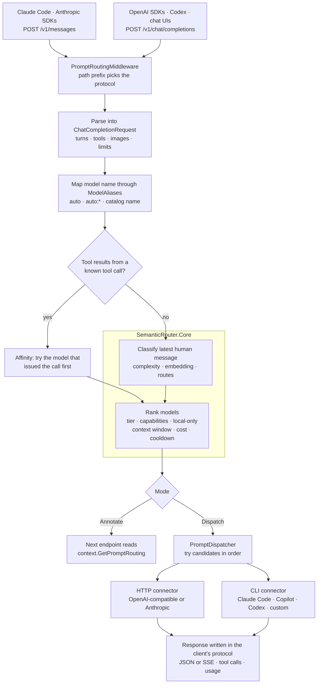
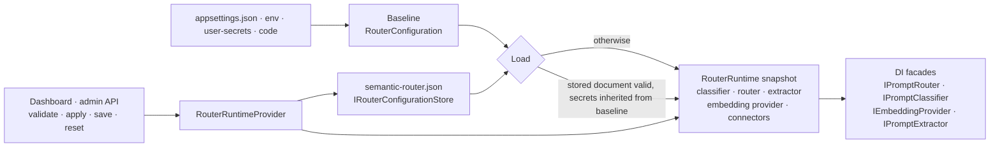

# Architecture

How a request moves through the router, how configuration reloads without dropping requests, and where to plug in your own code. For setup and options see the [README](../README.md), [providers.md](providers.md) and [dashboard.md](dashboard.md).

## Projects

| Project | Depends on | What it holds |
|---|---|---|
| `SemanticRouter.Core` | nothing | Vector math, token estimator, complexity heuristics, the route index, `DefaultRouteSelector`, `DefaultModelSelector`, `ModelHealthTracker`, `PromptRouter`, and the option types (`SemanticRouterOptions`, `RouteDefinition`, `ModelDefinition`, `TierDefinition`). Zero package references, AOT-compatible. |
| `SemanticRouter.AspNetCore` | Core, ASP.NET Core | Everything that touches HTTP and processes: the middleware and dispatcher, both wire protocols, connectors, the runtime and configuration store, the dashboard and its embedded assets. |
| `samples/RoutingApiSample` | AspNetCore | A host with an annotated `appsettings.json`: Annotate and Dispatch modes, dashboard, Anthropic endpoints. |
| `samples/LmStudioClaudePoc` | AspNetCore | The LM Studio plus Claude Code personal setup, with a preflight and a self-test. |
| `tests/SemanticRouter.Tests` | both | 285 tests; no network, model or vendor CLI needed. |

## One request, end to end

1. **Intercept.** `PromptRoutingMiddleware` handles `POST` requests with a JSON body on the configured path prefixes. `Middleware:PathPrefixes` carries OpenAI bodies, `Middleware:AnthropicPathPrefixes` (default `/v1/messages`) carries Anthropic bodies; `/v1/messages/count_tokens` is excluded and served by its own endpoint. The body is read once (up to `MaxRequestBodyBytes`) and handed on as a fresh stream.
2. **Parse.** `IPromptExtractor` finds the text to classify: the latest `user` message that is not only tool results, with injected `<system-reminder>` blocks removed. `ChatCompletionRequest` parses the same body into a protocol-neutral model: structured turns (text, image, tool call, tool result), tools, tool choice, sampling parameters, an input-size estimate, and whether the request continues a tool-calling turn.
3. **Map the model name.** Aliases are globs (`*haiku*` to `auto:cheapest`). A catalog model name or any `auto…` value is never remapped; a name that matches nothing routes as `auto`.
4. **Pin tool turns.** A request that carries tool results asks `IToolCallAffinity` which model issued those calls. If that model is enabled and not cooling down, it goes first (`RoutingReason.ConversationAffinity`), with the normally ranked models behind it as fallbacks.
5. **Classify.** `SemanticPromptClassifier`: complexity heuristics, then (unless the complexity short-circuit applies) one embedding call scored against the route index, then `DefaultRouteSelector` turns the scores into a required tier, capabilities and a local-only flag. Requirements only ever go up.
6. **Rank.** `DefaultModelSelector` filters by enabled, available, local (if required), capabilities (the request adds `tools` and `vision` itself), and context window, then orders by strategy. Models below the required tier follow when `AllowBelowRequiredTier` is on.
7. **Dispatch or annotate.** In Annotate mode the plan is attached to the request and the next endpoint decides. In Dispatch mode `PromptDispatcher` tries up to `MaxAttempts` candidates. A failure before any output cools the model down and moves on; once output has started the connector owns the response. An account-wide limit cools down every model on that connector.
8. **Write the reply in the client's protocol.** See the next section.
9. **Record.** A `RoutingActivityEntry` (decision, then outcome and timing) goes into the in-memory log that backs the dashboard's Activity and Live pages (pushed to them over `api/events`); metrics and routing headers are emitted. When memory sources are configured, the body was checked against the `MemoryIndex` while parsing, and the notes it carried are counted against every model in `SentTo` by the `MemoryExposureLog` ([memory.md](memory.md)).

## Two protocols, any backend

A connector either passes the client's body through or translates it.

| Client speaks | Backend speaks | What happens |
|---|---|---|
| OpenAI | OpenAI-compatible | Body forwarded with only `model` rewritten; response streamed back byte for byte. |
| Anthropic | Anthropic connector | Same, plus `x-api-key`, `anthropic-version` and the configured `ForwardHeaders`. |
| Anthropic | OpenAI-compatible | `OpenAIRequestBuilder` re-expresses the request (system prompt, `tool_use` to `tool_calls`, tool results to `tool` messages, images, stop sequences); `OpenAIResponseReader` reads the JSON or SSE reply and drives an `IChatResponseWriter` that writes Anthropic JSON or events. |
| OpenAI | Anthropic connector | The mirror image through `AnthropicRequestBuilder` and `AnthropicResponseReader`; consecutive same-role turns are merged because the Messages API requires alternation, and `max_tokens` gets a default. |
| either | CLI | `ChatTranscript` renders the conversation to text; the adapter builds the command line; the connector parses the CLI's output and drives the writer. With `ToolCalling: Prompted` the tools are described in the system prompt and `PromptedToolCalls` turns fenced `tool_call` blocks in the reply into structured calls. |

`IChatResponseWriter` is the single seam for output: `WriteTextAsync`, `StartToolCallAsync` / `WriteToolCallArgumentsAsync` / `EndToolCallAsync`, `CompleteAsync`. `OpenAIResponseWriter` and `AnthropicResponseWriter` implement the documented JSON and SSE shapes, so a new front door is a parser, a request builder and a writer.

What does not cross protocols is listed under *Known limitations* in the README (extended thinking, cache hints, structured-output parameters).

## Configuration and hot reload

- **`RouterConfiguration`** is one document: the whole `SemanticRouter` section (routing rules, tiers, models, connectors, embeddings, middleware). Its JSON shape equals the `appsettings.json` section, so documents move between the two.
- **`RouterRuntime`** is an immutable snapshot built from a document: classifier, router, extractor, embedding provider, connector catalog, parsed path prefixes and alias list. `RouterRuntimeProvider.Apply` validates, builds a new runtime, swaps it in with one reference write, starts the route-index warm-up in the background, then disposes the old runtime. In-flight requests keep the runtime they started with.
- **DI facades** (`RuntimeRouterFacade` and friends) forward every call to the current runtime, so a service that injected `IPromptRouter` at start-up never holds a stale instance. Registering your own implementation of one of these interfaces replaces the facade and is used as-is across reloads.
- **State that survives a reload** is registered once: `IModelHealth` (cooldowns), `IToolCallAffinity`, `RoutingActivityLog`, `MemoryIndex` and `MemoryExposureLog`, the metrics meter and the CLI process runner. All of it is in memory today; see the durable-state item in the [roadmap](roadmap.md).
- **Secrets** are masked as `***` on the way to the browser; sending the mask back keeps the stored value, and empty secrets in a stored document are filled from the baseline. Values may be references (`${env:…}`, `${secret:…}`): the runtime keeps the document as written (`Configuration`) and builds connectors and the embedding provider from a resolved copy (`Resolved`), never sent to the browser. A `SecretRedactor` built from the resolved values scrubs them from errors, relayed upstream bodies, activity and logs.

## The dashboard

`MapRouterDashboard` serves three embedded files (`index.html`, `app.css`, `app.js`) and the admin API under `{prefix}/api`. There is no build step and no dependency. The UI keeps one draft of the configuration in the browser, edits it through path-based bindings (`data-bind="Models.2.Tier"`), and talks to the same validation the router uses at start-up. Themes are token blocks keyed by `data-theme`; see [dashboard.md](dashboard.md#themes). The admin API answers loopback clients only unless that guard is turned off.

## Extension points

| To… | Implement or call |
|---|---|
| Reach a provider with its own protocol | `IChatConnector`, then `.AddConnector<T>()` |
| Use another embedding backend | `IEmbeddingProvider`, then `.UseEmbeddingProvider<T>()` |
| Change how requirements are derived | `IRouteSelector`, `IComplexityAnalyzer`, or `IPromptClassifier` |
| Change how models are ranked | `IModelSelector` |
| Share or persist cooldowns | `IModelHealth` |
| Share or persist tool-call affinity | `IToolCallAffinity` |
| Support another payload shape | `IPromptExtractor` |
| Keep configuration somewhere other than a file | `IRouterConfigurationStore`, then `.UseConfigurationStore<T>()` |
| Keep secrets in a vault or the OS keychain | `IRouterSecretStore`, then `.UseSecretStore<T>()` |

## Safety rules that shape the design

These are enforced in code and explained in [TERMS.md](TERMS.md): the router never reads or forwards credentials of a client or a CLI; CLI connectors answer loopback clients only and run in a fresh empty directory with their own tools off; subscription limits become cooldowns, never retries or account rotation; the admin API is loopback-only by default (remote access needs a token, and writes must come from the dashboard's own origin); and local-only routes can only be served by models marked local, including on failover.
