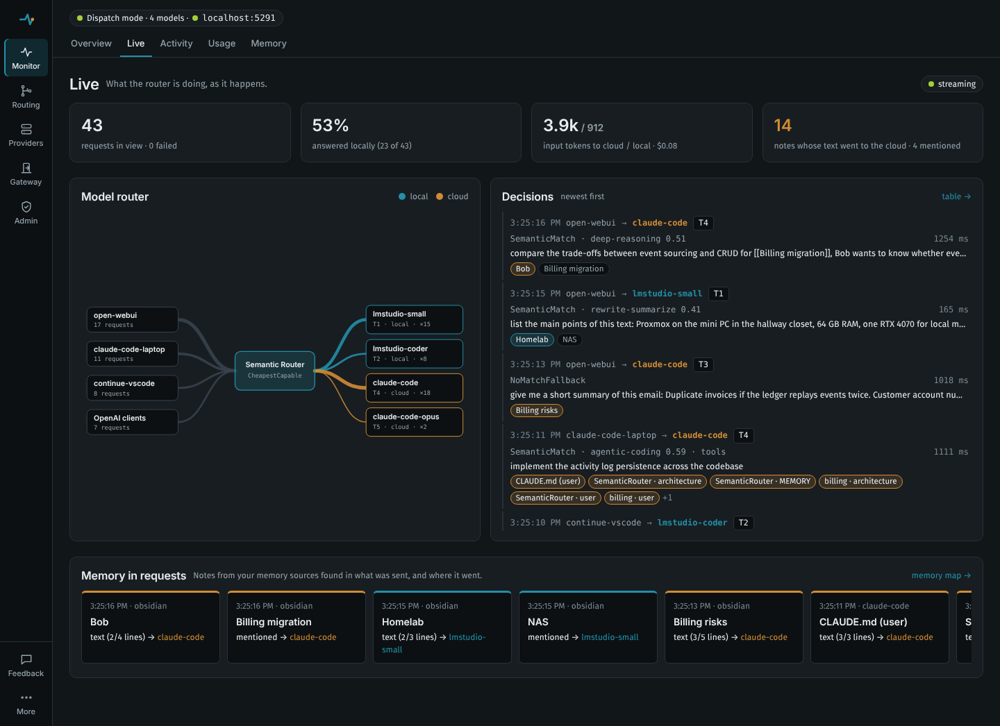

# The dashboard

A single-page app, embedded in `SemanticRouter.AspNetCore`, that shows what the router is doing and lets you change every setting with hot reload. No build step, no extra package.

```csharp
app.MapRouterDashboard("/router");   // UI at /router, admin API under /router/api
```

```csharp
builder.Services
    .AddSemanticPromptRouting(builder.Configuration.GetSection("SemanticRouter"))
    .UseConfigurationFile("semantic-router.json");   // optional: make dashboard changes survive restarts
```

## Pages

| Page | What it does |
|---|---|
| **Overview** | Counters, every model with its tier and health (ready, cooling down, disabled), the runtime (configuration version and source, store, embeddings state with the route index's size and warm-up time, classification-cache hit rate, gateway paths), served-by and required-tier charts, latency per connector (time to first byte p50/p95 and total p50 over the activity log), and **Try a prompt**: classify without calling a model, or send it through the gateway for real. |
| **Live** | What is happening now, pushed over server-sent events: tiles for requests, the share answered locally, input tokens (reported by the backend, or estimated) to cloud and local models, and notes whose text went to the cloud; a **model router** graph from clients (named by gateway key, or by protocol) through the router to every model, with the edge that just carried a request animated; a feed of decisions with the notes each request carried; and a strip of the latest memory crossings. |
| **Overview → Trends** | Requests per interval and p50/p95 latency over 1 hour, 24 hours, 7 or 30 days, with a table view. |
| **Usage** | Tokens and cost by model, connector, route, client, profile or day; "saved by routing" against a reference model; budgets with their state; the usage settings and budget editor. |
| **Activity** | The last 500 routed requests: prompt preview, protocol, tier, reason, route and similarity, the model that answered, attempt number, degraded flag, timing. Each entry shows its routing profile, project, the signals that kept it local, what the connector noted (a repaired or malformed tool call) and the time to the first byte under the total. Filter by failed, degraded, tool-bearing or profile. **Label** says which tier a prompt should have had: it adds the prompt to the evaluation set and, optionally, as an utterance to a route. |
| **Memory** | The [memory map](memory.md): notes from an Obsidian vault, Claude Code's memory or the MCP memory server as a force-directed graph, coloured by where they have been sent (text to the cloud, mentioned to the cloud, local only, not sent) or by source or folder. Search, filter, select a note for its links and per-model counts; notes pulse as requests carry them. The memory sources are edited here too. |
| **Tiers** | The capability ladder with names and descriptions, and a matrix of which routes require each tier and which models provide it. Shows at a glance when a tier has nothing that can serve it. |
| **Routes** | Intent clusters: name, tier, required capabilities, threshold, local-only, utterances. |
| **Evaluate** | Runs the evaluation set through the configuration: accuracy, too-low and too-high counts, accuracy per tier, a confusion matrix, the misrouted prompts with their scores, a threshold sweep with recommended values, route health, and a comparison with another embedding model. See [routing-quality.md](routing-quality.md). |
| **Models** | The catalog, grouped by connector with each group's tiers at a glance: connector, provider model id (with **Discover**, which suggests the connector's model ids), tier, capabilities, context window, costs, priority, active hours, local flag, enabled. **Discover models** on a connector lists everything it offers (load state, size, context, which models are already in the catalog) with a suggested name, tier and capabilities for each; tick the ones you want, adjust them, and **Add selected** puts them in the draft. See [Model lineups](providers.md#model-lineups-several-models-per-provider). |
| **Connectors** | HTTP (OpenAI-compatible or Anthropic): base address, path, API key, headers, forwarded headers, timeout. CLI: preset, executable, extra arguments, tool calling (with streaming and repair switches), quota patterns, environment, concurrency and queue limit. Copilot: the CLI the SDK runs, its home directory, concurrency, queue limit. **Discover models** lists what the connector offers, as on the Models page. |
| **Routing rules** | Similarity threshold, fallback tier, ambiguity margin, scoring strategy, complexity short-circuit, complexity → tier rules, selection strategy and failover, cooldowns, the time zone for model active hours, complexity heuristic weights and keywords. |
| **Profiles** | Routing profiles (allowed and denied models and connectors, tier floor and cap, strategy, local-only), how a request picks one (headers, client mappings, rules), virtual models, and the content signals that keep a conversation local. **What would each profile do?** routes one prompt under every profile side by side. See [routing-profiles.md](routing-profiles.md). |
| **Embeddings** | Provider (Hashing, Onnx in-process, or an OpenAI-compatible server), model, endpoint, batch size, timeout, warm-up, and a probe that embeds a sentence with the applied provider. For ONNX models it shows the suggested threshold and can apply it. |
| **Gateway** | Mode (Dispatch or Annotate), OpenAI and Anthropic path prefixes, model aliases, tool-turn pinning, system-reminder stripping, body limit, response headers, fail-open, message selection. |
| **Connect clients** | Ready-to-paste snippets for Claude Code, OpenAI SDKs, Codex CLI and curl, filled in with the router's address. |
| **JSON** | The whole document as text (the same shape as the `SemanticRouter` section of `appsettings.json`): edit, download, compare with the application baseline, reset. **History** lists every applied version (when, what applied it, who), diffs any of them against the draft and rolls back to it. |



## Apply, save, revert

Editing never touches the running router until you choose:

- **Validate** runs the same checks the router runs on start-up and lists problems.
- **Apply** builds a new runtime from the draft and swaps it in atomically. In-flight requests finish on the old runtime; new ones use the new one. Model cooldowns are kept.
- **Apply & save** also writes the document to the configuration store, when one is registered.
- **Discard** drops the draft.

**Reset** (JSON page) rebuilds from the application's own configuration for this process. The stored file is left in place; save again to overwrite it.

## Where the configuration comes from

1. The application's `SemanticRouter` section (`appsettings.json`, environment variables, user-secrets, code) is the **baseline**.
2. With `UseConfigurationFile(path)` (or a custom `IRouterConfigurationStore`), a saved document **replaces** the baseline on start-up. Secrets left empty in the document (connector `ApiKey`, header values, the embeddings key) are inherited from the baseline, so keys can stay in user-secrets or environment variables.
3. Without a store, changes apply in memory and are lost on restart; the UI says so.

Applied documents are kept in the configuration history: in memory by default, or on disk with `UseSqliteState` (see [architecture.md](architecture.md#durable-state)).

Secrets are never sent to the browser: the API masks them as `***`, and sending `***` back keeps the stored value.

## Keeping secrets out of the file

Three ways to give a connector its key, from safest to least safe:

1. **Leave the field empty** and keep the key in user-secrets or an environment variable (`SemanticRouter__Connectors__openai__ApiKey`). The saved document inherits it from the baseline.
2. **Write a reference** in the field: `${env:OPENAI_API_KEY}` reads an environment variable each time the configuration is applied; `${secret:connectors/openai/ApiKey}` reads the secret store. A reference can sit inside a value (`Bearer ${env:TOKEN}` in a header). References are shown as they are (they are not secrets), and an unresolved one is listed as a warning in the banner, in `GET api/status` (`warnings`) and in the log.
3. **Type the key.** With a secret store registered (`.UseSecretFile()`, or your own `IRouterSecretStore` through `.UseSecretStore<T>()`), **Apply & save** moves it into the store and the file keeps a `${secret:…}` reference. `UseSecretFile` encrypts values with ASP.NET Core Data Protection into `{config name}.secrets.json` next to the configuration file; the data-protection keys stay in your user profile (DPAPI-protected on Windows), so a copy of the configuration directory carries no usable key. Without a store, the key is written to the file in plain text and the save says so, with these alternatives.

References work in connector `ApiKey` and `Headers`, CLI `EnvironmentVariables`, `Embeddings:ApiKey`, `Middleware:GatewayKeys` and the dashboard tokens. Resolved values are redacted (`***`) from 503 details, relayed upstream errors, activity entries and log messages, so a backend that echoes a key back cannot leak it through the router.

## Admin API

All under the dashboard prefix, JSON in and out. Who may call it is described in [Access and security](#access-and-security).

| Method and path | Purpose |
|---|---|
| `GET api/status` | Runtime version and source, warm-up state, tiers, models with cooldowns, connectors, routes, gateway settings, activity counters. |
| `GET api/config` | The active document (masked) with version, source and store location. |
| `GET api/config/baseline` | The application's own configuration (masked). |
| `POST api/config/validate` | Validation errors for a document. |
| `PUT api/config?persist=true\|false` | Validate, apply, and save (default) or apply in memory. `400` with `errors` when invalid. |
| `POST api/config/reset` | Back to the baseline. |
| `GET api/config/history?limit=50` | Applied versions, newest first: `id`, `timestamp`, `source` (`startup`, `admin API`, `reset`, `rollback`), `actor`, `note`. `PUT api/config?note=...` sets the note. |
| `GET api/config/history/{id}` | That version's document (masked). |
| `POST api/config/history/{id}/rollback` | Apply and save that version; recorded as a `rollback`. |
| `GET api/activity?limit=100&after=<id>` | Recent routing activity. Entries carry `sentTo` (the models a request was sent to, failed attempts included) and `memory` (notes found in it); `feedback` maps entry ids to the [feedback](routing-quality.md#feedback) they received. |
| `GET api/feedback?limit=200` | Recent feedback about routing decisions, newest first. |
| `GET api/feedback/summary?days=7` | Decisions and feedback per route and per model, with the share that received feedback. |
| `GET api/tuning`, `POST api/tuning/run`, `POST api/tuning/changes/{id}/undo` … | [Automatic tuning](routing-quality.md#automatic-tuning): what the router learned, why, and undo. |
| `GET api/reliability`, `POST api/reliability/reset` | [Model reliability](routing-quality.md#model-reliability) per route and with tools, and offering a left-out model again. |
| `GET api/activity/series?window=1h\|24h\|7d\|30d` | Counts, mix and latency percentiles per bucket. |
| `GET api/activity/export?format=csv\|jsonl&prompts=false&since=&until=` | Download activity; prompt previews only with `prompts=true`. |
| `GET api/usage?window=day\|week\|month\|7d\|30d&by=model\|connector\|route\|client\|day` | Usage totals and groups, the reference model and every budget's state. |
| `GET api/events` | Server-sent events for live views: `activity` when a request is routed and again when it finishes, and a keep-alive comment every 15 s. |
| `GET api/memory` | The memory map and sharing counts ([memory.md](memory.md#api)). |
| `POST api/memory/refresh` | Rescan the memory sources. |
| `POST api/memory/exposure/reset` | Forget which notes were sent where. |
| `POST api/classify` | `{ "prompt": "...", "model": "auto" }` → the routing plan, without calling a model. |
| `POST api/health/reset` | Clear every cooldown. |
| `GET/PUT api/evaluation/set`, `POST api/evaluation/cases`, `GET api/evaluation/set/export` | The evaluation set. See [routing-quality.md](routing-quality.md#api). |
| `POST api/evaluate?calibrate=true`, `POST api/evaluate/compare`, `GET api/routes/health` | Evaluate, calibrate, compare embedding models, check routes. |
| `GET api/themes` | Built-in themes and theme files, with missing tokens and contrast issues; the files are served at `{prefix}/themes/{id}.css`. |
| `POST api/routes/{name}/utterances` | Add an utterance (or create the route) and apply. |
| `POST api/embeddings/test` | Embed a sentence with the applied provider. |
| `POST api/connectors/{name}/discover` | What the connector offers: `models` (ids it serves), `server` (`LM Studio`, `Ollama`), `loading` (`OnDemand`, `LoadedOnly`, `Unknown`) with `loadingNote`, and `lineup`: per model its `kind`, `listed`, `loaded`, `contextLength`, `parametersBillions`, `capabilities`, `inCatalog`, `recommended`, `reason` and a `suggestion` in the configuration document's shape. HTTP connectors are asked (`/v1/models`, plus LM Studio's and Ollama's own APIs on local addresses), the Copilot SDK lists your account's models, and CLI presets return the names they accept. A `401` is reported as "requires authentication", naming the key to set. |
| `GET api/session` | `{ role, tokenRequired, tokensConfigured }` for the caller. |
| `POST api/session` | `{ "token": "..." }` → sets the session cookie. |
| `DELETE api/session` | Signs out. |

`PUT api/config`, `POST api/config/reset`, rollback, `POST api/health/reset`, `POST api/memory/exposure/reset`, changes to the evaluation set, adding utterances and `POST api/evaluate/compare` (which calls an endpoint you name) need the admin role; everything else is open to the read-only role.

The same document works with `PUT` from scripts, e.g. to promote a tested configuration:

```bash
curl -X PUT http://localhost:5080/router/api/config -H 'Content-Type: application/json' --data @semantic-router.json
```

## Access and security

The admin API can change where prompts go, so the default is strict and opening it up takes two explicit settings.

| Setup | Settings | What happens |
|---|---|---|
| **Loopback only** (default) | nothing | Requests from other machines get `403`. Loopback requests must carry a `Host` header naming this machine (`localhost`, `127.0.0.1`, `[::1]`, or a `PublicOrigins` entry), which stops a web page from reaching the dashboard through DNS rebinding. |
| **Token** | `RequireLocalClient: false`, `AdminToken` (and optionally `ReadOnlyToken`) | Remote callers send `Authorization: Bearer <token>`, or sign in on the dashboard, which sets an `HttpOnly`, `SameSite=Strict` session cookie derived from the token (never the token itself; changing the token signs everyone out). The read-only token can view status, activity and the masked configuration and use the prompt tester; it cannot apply, save or reset. Loopback clients still need no token. |
| **Reverse proxy that authenticates** | `RequireLocalClient: false`, `AllowUnauthenticatedRemoteClients: true` | Remote callers are trusted. Only for a proxy that authenticates every request; a warning is logged at start-up. |

```jsonc
"SemanticRouter": {
  "Dashboard": {
    "RequireLocalClient": false,
    "AdminToken": "${env:ROUTER_ADMIN_TOKEN}",       // 16+ characters, e.g. `openssl rand -hex 24`
    "ReadOnlyToken": "${env:ROUTER_VIEW_TOKEN}",
    "PublicOrigins": [ "https://router.home.lan" ]    // where people browse to it, if not localhost
  }
}
```

The same settings are on `RouterDashboardOptions` (`app.MapRouterDashboard("/router", o => ...)` runs after the bound section). With `RequireLocalClient: false` and no token, remote requests are still refused and the log says what to configure.

Whatever the setup:

- **Writes must come from the dashboard's own origin.** `PUT`, `POST` and `DELETE` with an `Origin` other than the request's host (or a `PublicOrigins` entry), or with `Sec-Fetch-Site: cross-site`, get `403`. Scripts that send no `Origin` (curl) are unaffected.
- **A reverse proxy on this machine makes every request look local.** Use ASP.NET Core's forwarded-headers middleware so the real client address is seen, or set `RequireTokenForLocalClients: true`.
- **Subscription CLI connectors stay loopback-only** (`AllowRemoteClients: false`) whatever the dashboard allows: a remote client's request falls through to an API-key or local model. Serving other people from your personal subscription is what [TERMS.md](TERMS.md) rules out.

### Gateway keys

The chat endpoints (`/v1/chat/completions`, `/v1/messages`) are separate from the dashboard. To tell clients of a shared router apart, give each one a key under `Middleware:GatewayKeys` (`"laptop": "${env:ROUTER_KEY_LAPTOP}"`). Remote requests without a valid key get `401` in their protocol's error format; the matched name appears in the Activity page (`client`). Clients send the key the way they send any API key: `ANTHROPIC_AUTH_TOKEN` or `ANTHROPIC_API_KEY` for Claude Code, `OPENAI_API_KEY` for OpenAI clients. Keys are compared in constant time and never logged or forwarded; backends always get the connector's own credentials. Loopback clients may omit the key unless `RequireGatewayKeyForLocalClients` is on. `GET /v1/models` and `count_tokens` are not covered.

## Themes

Themes are token blocks in `app.css`: every colour, font and radius the UI uses is a CSS variable set per `[data-theme]`, and the rest of the stylesheet only refers to the variables. The default, **Machine Dark**, is built on two colours: blue `#228fa7` for the working surfaces (primary actions, navigation, links, focus) and orange `#d08c34` for signals (the tier decision, warnings, cooldowns, the second chart), on near-black surfaces with Inter headings and Fira Sans text. Green and red are kept for status only. **Machine Light** uses the same two colours with darker ink variants for small text, and **Terminal** is a green-on-black alternative.

Every built-in theme meets WCAG AA (4.5:1) for body and small text. That includes the status colours on their tinted badge fills and the ink on the blue and orange buttons. A test checks it on every build.

### Adding a theme without rebuilding

Drop a token file into the **themes directory**: `themes/` next to the configuration file (for the tool, next to `semantic-router.json`), or `Dashboard:ThemesDirectory`. After a reload the theme appears in the picker under **Theme files**. Nothing is rebuilt or restarted.

```css
/* themes/ocean.css: the file name is the theme id (lower-case letters, digits and dashes). */
:root[data-theme="ocean"] {
  color-scheme: dark;
  --bg: #0b1726;
  --text: #e6f0fa;
  /* … the rest of the tokens below … */
}
```

An optional manifest next to it gives the display name; without one, the picker shows the id in title case:

```json
{ "name": "Ocean" }
```

**Tokens.** A theme should declare every colour token:
- `color-scheme`
- surfaces and borders: `--bg`, `--bg-elevated`, `--bg-sunken`, `--bg-hover`, `--border`, `--border-strong`
- text: `--text`, `--text-muted`, `--text-faint`
- the working colour: `--accent`, `--accent-ink` (small text and links), `--accent-contrast` (text on accent fills), `--accent-soft`
- the signal colour: `--signal`, `--signal-ink`, `--signal-soft`, `--signal-contrast`
- status: `--ok`, `--warn`, `--danger` and `--info`, each with a `-soft` fill
- charts: `--series-1`, `--series-2`
- `--brand-mark-bg` and `--shadow`

Fonts (`--font-heading`, `--font-body`, `--font-mono`) and radii (`--radius`, `--radius-lg`) are optional. A token the file leaves out falls back to Machine Dark's value.

**Checks.** `GET api/themes` lists every theme with:
- the tokens it is missing;
- its text and surface pairs below 4.5:1, computed the way WCAG defines contrast, with badge fills blended over their surface;
- a problem when the file declares no tokens for its own id.

The picker marks such themes with ⚠ and lists the issues in the option's tooltip.

To add a built-in theme instead, add a token block to `app.css` and `{ id, name }` to `THEMES` in `js/core.js`. The contrast test then covers it too.

## Accessibility

- **Structure.** Landmarks: a navigation with the pages, a main region, and a skip link to it. The current page is marked `aria-current`, and every form control has a label (the end-to-end tests fail when one loses it).
- **Keyboard.** Everything works from the keyboard, and focus is always visible. Expandable items (routes, models, connectors, profiles, memory sources) are buttons that open with Enter or Space. After navigation, focus moves to the page content.
- **Small screens.** Below 720 px the navigation becomes a drawer behind a menu button. Escape closes it.
- **Motion.** `prefers-reduced-motion` turns off transitions, the router graph's flowing edges and the memory map's pulses.

## Testing the dashboard

`tests/dashboard-e2e` is a Playwright suite run in CI against the real `semantic-router` host and a stub model backend. It:
- visits every page, failing on any script or console error and on any control without an accessible name;
- edits and applies a route, adds a model, renames a connector (its models follow), and checks that validation errors appear and that discard restores the configuration;
- runs the prompt tester, switches themes and checks the choice is remembered, and picks up a theme file dropped in at run time;
- checks keyboard operation, the phone navigation and contrast;
- compares screenshots of the three built-in themes at desktop and phone widths.

```bash
dotnet build -c Release
cd tests/dashboard-e2e && npm ci && npx playwright install chromium
npm test                       # or: npm run update-screenshots after an intended visual change
```

The page code is plain JavaScript in native ES modules under `wwwroot/js/` (no build step, no dependencies). `app.js` is the entry point, `core.js` holds state and helpers, `shell.js` holds loading, chrome, themes and routing, and there is one module per group of pages.
